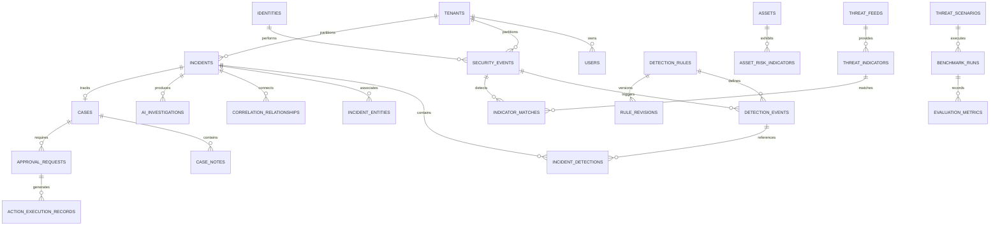

# CyberTrace — Data Model & API Contracts Specification
## Relational Schema Architecture, SQLAlchemy Models & Versioned REST Endpoints

---

## 1. Relational Database Schema & Entity Relationships

The CyberTrace persistence layer utilizes SQLAlchemy 2.0 with asynchronous drivers (`aiosqlite` for local development; `asyncpg` for production PostgreSQL). All timestamps are stored as timezone-aware UTC (`DateTime(timezone=True)`).



---

## 2. SQLAlchemy Model Definitions

### 2.1 Core Telemetry & Incident Schema (Existing)
- **`SecurityEventModel` (`security_events`):** Stores normalized Common Event Schema (CES) records. Primary key: `id` (e.g. `evt_...`). Unique constraints on `(id, tenant_id)`. Indexed by `timestamp`, `category`, `action`, `username`, `source_ip`, `hostname`.
- **`DetectionRuleModel` (`detection_rules`):** Catalogs authoritative detection rules. Indexed by `rule_id` (`DET-001`, `DET-002`, etc.), `severity`, `is_active`.
- **`DetectionEventModel` (`detection_events`):** Records rule executions. Stores `rule_id`, `entity_type`, `entity_value`, `detected_at`, `explanation`.
- **`IncidentModel` (`incidents`):** Correlated incident entities. Stores `correlation_key`, `title`, `severity`, `status`, `first_seen`, `last_seen`.
- **`AIInvestigationModel` (`ai_investigations`):** Persists investigation findings. Stores `model_id`, `status` (`completed`, `fallback`), `executive_summary`, `structured_result` (JSON), `event_citations` (JSON), `tool_call_count`, `duration_seconds`, `request_id`, `created_at`.
- **`SavedHuntModel` (`saved_hunts`):** Persisted threat hunting query definitions (Phase 6.3A). Stores `id` (`hunt_...`), `name` (indexed), `description`, `tags` (JSON array), `query_definition` (validated AST JSON), `created_by` (caller-supplied demo metadata), `created_at` (indexed), `updated_at`, `version` (optimistic concurrency lock starting at 1), `last_run_at`, `run_count`, `is_archived` (indexed boolean soft-delete flag).

### 2.2 Advanced Platform Models (New Extensions)

#### Detection-as-Code & Sigma Subsystem
```python
class DetectionRuleDefinitionModel(Base):
    __tablename__ = "detection_rule_definitions"

    id: Mapped[str] = mapped_column(String(64), primary_key=True)
    rule_id: Mapped[str] = mapped_column(String(32), unique=True, index=True)
    title: Mapped[str] = mapped_column(String(256), nullable=False)
    description: Mapped[str] = mapped_column(Text, nullable=False)
    severity: Mapped[str] = mapped_column(String(16), nullable=False, index=True)
    sigma_yaml: Mapped[str] = mapped_column(Text, nullable=False)
    mitre_attack_tactics: Mapped[List[str]] = mapped_column(JSON, default=list)
    mitre_attack_techniques: Mapped[List[str]] = mapped_column(JSON, default=list)
    is_active: Mapped[bool] = mapped_column(Boolean, default=True, index=True)
    version: Mapped[int] = mapped_column(Integer, default=1)
    created_at: Mapped[datetime] = mapped_column(DateTime(timezone=True), default=lambda: datetime.now(timezone.utc))
    updated_at: Mapped[datetime] = mapped_column(DateTime(timezone=True), default=lambda: datetime.now(timezone.utc))

    revisions: Mapped[List["RuleRevisionModel"]] = sa_relationship("RuleRevisionModel", back_populates="rule")


class RuleRevisionModel(Base):
    __tablename__ = "rule_revisions"

    id: Mapped[str] = mapped_column(String(64), primary_key=True)
    rule_id: Mapped[str] = mapped_column(String(32), ForeignKey("detection_rule_definitions.rule_id", ondelete="CASCADE"), index=True)
    version: Mapped[int] = mapped_column(Integer, nullable=False)
    sigma_yaml: Mapped[str] = mapped_column(Text, nullable=False)
    change_summary: Mapped[str] = mapped_column(String(512), nullable=False)
    author_id: Mapped[str] = mapped_column(String(64), nullable=False)
    created_at: Mapped[datetime] = mapped_column(DateTime(timezone=True), default=lambda: datetime.now(timezone.utc))

    rule: Mapped["DetectionRuleDefinitionModel"] = sa_relationship("DetectionRuleDefinitionModel", back_populates="revisions")
```

#### Assets & Identity Intelligence
```python
class AssetInventoryModel(Base):
    __tablename__ = "asset_inventory"

    id: Mapped[str] = mapped_column(String(64), primary_key=True)
    hostname: Mapped[str] = mapped_column(String(128), unique=True, index=True)
    asset_type: Mapped[str] = mapped_column(String(32), nullable=False) # server, workstation, domain_controller, gateway
    criticality: Mapped[str] = mapped_column(String(16), nullable=False, index=True) # tier_1, tier_2, tier_3, tier_4
    ip_addresses: Mapped[List[str]] = mapped_column(JSON, default=list)
    owner: Mapped[Optional[str]] = mapped_column(String(128), nullable=True)
    os_info: Mapped[Optional[str]] = mapped_column(String(128), nullable=True)
    first_seen: Mapped[datetime] = mapped_column(DateTime(timezone=True), nullable=False)
    last_seen: Mapped[datetime] = mapped_column(DateTime(timezone=True), nullable=False, index=True)
    tags: Mapped[List[str]] = mapped_column(JSON, default=list)


class IdentityProfileModel(Base):
    __tablename__ = "identity_profiles"

    id: Mapped[str] = mapped_column(String(64), primary_key=True)
    username: Mapped[str] = mapped_column(String(128), unique=True, index=True)
    display_name: Mapped[Optional[str]] = mapped_column(String(128), nullable=True)
    identity_type: Mapped[str] = mapped_column(String(32), default="user") # user, service_account, admin
    department: Mapped[Optional[str]] = mapped_column(String(64), nullable=True)
    observed_ips: Mapped[List[str]] = mapped_column(JSON, default=list)
    failed_logon_count_24h: Mapped[int] = mapped_column(Integer, default=0)
    last_successful_logon: Mapped[Optional[datetime]] = mapped_column(DateTime(timezone=True), nullable=True)
    risk_score: Mapped[int] = mapped_column(Integer, default=0) # 0 - 100
```

#### ThreatLab Benchmark & Replay Subsystem
```python
class ThreatScenarioModel(Base):
    __tablename__ = "threat_scenarios"

    id: Mapped[str] = mapped_column(String(64), primary_key=True)
    name: Mapped[str] = mapped_column(String(128), unique=True, index=True)
    description: Mapped[str] = mapped_column(Text, nullable=False)
    attack_category: Mapped[str] = mapped_column(String(64), nullable=False)
    event_count: Mapped[int] = mapped_column(Integer, nullable=False)
    expected_detection_count: Mapped[int] = mapped_column(Integer, nullable=False)
    expected_rule_ids: Mapped[List[str]] = mapped_column(JSON, default=list)
    dataset_file_path: Mapped[str] = mapped_column(String(256), nullable=False)
    created_at: Mapped[datetime] = mapped_column(DateTime(timezone=True), default=lambda: datetime.now(timezone.utc))


class BenchmarkRunModel(Base):
    __tablename__ = "benchmark_runs"

    id: Mapped[str] = mapped_column(String(64), primary_key=True)
    scenario_id: Mapped[str] = mapped_column(String(64), ForeignKey("threat_scenarios.id", ondelete="CASCADE"), index=True)
    executed_by: Mapped[str] = mapped_column(String(64), nullable=False)
    true_positives: Mapped[int] = mapped_column(Integer, nullable=False)
    false_positives: Mapped[int] = mapped_column(Integer, nullable=False)
    false_negatives: Mapped[int] = mapped_column(Integer, nullable=False)
    precision: Mapped[float] = mapped_column(Float, nullable=False)
    recall: Mapped[float] = mapped_column(Float, nullable=False)
    f1_score: Mapped[float] = mapped_column(Float, nullable=False)
    duration_seconds: Mapped[float] = mapped_column(Float, nullable=False)
    executed_at: Mapped[datetime] = mapped_column(DateTime(timezone=True), default=lambda: datetime.now(timezone.utc), index=True)
```

#### SOC Case Management & Response Playbooks
```python
class CaseModel(Base):
    __tablename__ = "cases"

    id: Mapped[str] = mapped_column(String(64), primary_key=True)
    incident_id: Mapped[str] = mapped_column(String(64), ForeignKey("incidents.id", ondelete="CASCADE"), unique=True, index=True)
    title: Mapped[str] = mapped_column(String(256), nullable=False)
    priority: Mapped[str] = mapped_column(String(16), default="P2", index=True) # P1, P2, P3, P4
    status: Mapped[str] = mapped_column(String(32), default="new", index=True) # new, in_progress, pending_approval, closed
    assignee_id: Mapped[Optional[str]] = mapped_column(String(64), nullable=True, index=True)
    created_at: Mapped[datetime] = mapped_column(DateTime(timezone=True), default=lambda: datetime.now(timezone.utc), index=True)
    updated_at: Mapped[datetime] = mapped_column(DateTime(timezone=True), default=lambda: datetime.now(timezone.utc))
    closed_at: Mapped[Optional[datetime]] = mapped_column(DateTime(timezone=True), nullable=True)
    closure_reason: Mapped[Optional[str]] = mapped_column(String(128), nullable=True)

    notes: Mapped[List["CaseNoteModel"]] = sa_relationship("CaseNoteModel", back_populates="case")
    approvals: Mapped[List["ApprovalRequestModel"]] = sa_relationship("ApprovalRequestModel", back_populates="case")


class ApprovalRequestModel(Base):
    __tablename__ = "approval_requests"

    id: Mapped[str] = mapped_column(String(64), primary_key=True)
    case_id: Mapped[str] = mapped_column(String(64), ForeignKey("cases.id", ondelete="CASCADE"), index=True)
    playbook_id: Mapped[str] = mapped_column(String(64), nullable=False)
    action_name: Mapped[str] = mapped_column(String(128), nullable=False)
    rationale: Mapped[str] = mapped_column(Text, nullable=False)
    target_entity: Mapped[str] = mapped_column(String(128), nullable=False)
    status: Mapped[str] = mapped_column(String(32), default="pending", index=True) # pending, approved, rejected
    requested_by: Mapped[str] = mapped_column(String(64), nullable=False)
    decided_by: Mapped[Optional[str]] = mapped_column(String(64), nullable=True)
    decision_reason: Mapped[Optional[str]] = mapped_column(String(256), nullable=True)
    created_at: Mapped[datetime] = mapped_column(DateTime(timezone=True), default=lambda: datetime.now(timezone.utc))
    decided_at: Mapped[Optional[datetime]] = mapped_column(DateTime(timezone=True), nullable=True)

    case: Mapped["CaseModel"] = sa_relationship("CaseModel", back_populates="approvals")
```

---

## 3. Versioned REST API Specifications (`/api/v1`)

### 3.1 Overview & System
- `GET /api/v1/health`: Returns API health, service name, and version.
- `GET /api/v1/overview/stats`: Returns operational overview metrics (incident severity counts, monitored asset counts, detection coverage percentage, model provider health). Data tagged with `provenance: "live_telemetry"` or `"synthetic_benchmark"`.

### 3.2 Ingestion & Interoperability
- `POST /api/v1/logs/upload`: Multipart file upload (bounded max 50 MB) supporting JSON, CSV, Syslog, Windows, Zeek. Returns parsed event count, detection count, and incident count.
- `POST /api/v1/interop/ocsf/export`: Accepts incident ID; returns standardized OCSF 1.1 JSON object array.
- `POST /api/v1/interop/ocsf/import`: Ingests standard OCSF JSON records and maps them to CES.

### 3.3 Detection Engineering
- `GET /api/v1/rules`: Lists detection rules with filters for `is_active`, `severity`, `mitre_tactic`.
- `POST /api/v1/rules`: Creates a new detection rule (accepts YAML Sigma subset or structured parameters).
- `PUT /api/v1/rules/{rule_id}`: Updates rule definition and records a new revision.
- `POST /api/v1/rules/{rule_id}/toggle`: Enables or disables a rule with audit reason.
- `GET /api/v1/rules/mitre-matrix`: Returns ATT&CK coverage heatmap matrix with rule counts per tactic/technique.

### 3.4 Threat Hunting
- `POST /api/v1/hunting/query`: Executes structured search filter.
  - *Request Body:*
    ```json
    {
      "time_range": {"start": "2026-11-01T00:00:00Z", "end": "2026-11-01T23:59:59Z"},
      "filters": [
        {"field": "username", "operator": "eq", "value": "svc_deploy"},
        {"field": "action", "operator": "in", "value": ["logon_failure", "elevation_attempt"]}
      ],
      "limit": 100,
      "offset": 0
    }
    ```
- `GET /api/v1/hunting/saved`: Retrieves saved hunt queries.
- `POST /api/v1/hunting/saved`: Saves a hunt query with title and hypothesis notes.

### 3.5 Incidents & Investigation
- `GET /api/v1/incidents`: Lists correlated incidents with filters for status, severity, time range.
- `GET /api/v1/incidents/{incident_id}`: Returns incident dossier (metadata, detections, events, entities).
- `PATCH /api/v1/incidents/{incident_id}/status`: Updates the lifecycle status of an incident.
  - *Request Body:* `{"status": "open" | "investigating" | "contained" | "closed" | "false_positive"}`
  - *Response:* Updated `IncidentResponse` with new status and updated timestamp.
- `PATCH /api/v1/incidents/{incident_id}/triage`: Updates incident triage metadata (severity, analyst notes, tags).
- `GET /api/v1/incidents/{incident_id}/graph`: Returns graph nodes and edges for React Flow visualization, with edges explicitly typed as `observed`, `correlated`, or `inferred`.
- `POST /api/v1/incidents/{incident_id}/investigate`: Starts an AI or fallback investigation.
  - *Query Param:* `model_id` (optional: `qwen-3.8-27b`, `deepseek-v4.1-flash`, or `auto`).
  - *Response:* `InvestigationResponse` (executive summary, observed facts, hypotheses, unknowns, recommended actions, limitations).
- `GET /api/v1/incidents/{incident_id}/investigations`: Lists historical investigations.
- `GET /api/v1/incidents/{incident_id}/investigations/{investigation_id}`: Fetches specific investigation run.

### 3.6 ThreatLab (Evaluation Studio)
- `GET /api/v1/threatlab/scenarios`: Catalogs available synthetic attack scenarios.
- `POST /api/v1/threatlab/replay`: Executes a replay run of a scenario against active detection rules.
  - *Request:* `{"scenario_id": "scen_brute_exfil_01", "rule_ids": ["DET-001", "DET-002", "DET-004"]}`
  - *Response:* `BenchmarkRunResponse` containing TP, FP, FN, Precision, Recall, F1 score, and missed event IDs.

### 3.7 SOC Case Management & Playbooks
- `POST /api/v1/cases`: Opens a case linked to an incident.
- `GET /api/v1/cases/{case_id}`: Retrieves case status, SLA, assigned analyst, and notes.
- `POST /api/v1/cases/{case_id}/notes`: Appends an investigation note.
- `POST /api/v1/cases/{case_id}/playbooks/simulate`: Simulates running a response playbook.
- `POST /api/v1/cases/{case_id}/approvals/{approval_id}/decide`: Approves or rejects a response action.

### 3.8 Asset & Identity Intelligence (Phase 6.1)
- `GET /api/v1/assets`: Paginated list of observed assets (hostnames and IPs) derived directly from `security_events`.
  - *Query Params:* `asset_type` (`hostname` | `ip`), `search` (substring match), `limit` (max 200, default 50), `offset` (default 0).
  - *Ordering:* Global database-level sort on `last_seen DESC, asset_value ASC, asset_type ASC`.
  - *Provenance:* Marked with `"provenance": "observed_telemetry"`.
- `GET /api/v1/assets/{asset_type}/{asset_value}`: Detailed profile for a specific observed asset.
  - *Parameters:* `asset_type` (`hostname` | `ip`), `asset_value` (URL-decoded path parameter).
  - *Normalization:* Hostnames normalized to uppercase; IPs trimmed.
  - *Payload:* `AssetDetail` containing first seen, last seen, distinct event counts (source/destination/total), detection count, incident count, triggered detection rules summary, and linked incident IDs.
  - *Response:* Returns 404 when not observed in any ingested event.
- `GET /api/v1/identities`: Paginated list of observed user identities derived from `security_events.username`.
  - *Query Params:* `search` (substring match), `limit` (max 200, default 50), `offset` (default 0).
  - *Normalization:* Canonical lowercase grouping (`LOWER(TRIM(username))`).
  - *Ordering:* `last_seen DESC, username ASC`.
  - *Provenance:* Marked with `"provenance": "observed_telemetry"`.
- `GET /api/v1/identities/{username}`: Detailed profile for a specific observed user identity.
  - *Parameters:* `username` (URL-decoded path parameter; canonical lowercase lookup).
  - *Payload:* `IdentityDetail` containing first seen, last seen, distinct event count, detection count, incident count, triggered detection rules, and linked incident IDs.
  - *Response:* Returns 404 when not observed in any ingested event.

---

### 3.9 Structured Threat Hunting Query Engine (Phase 6.2)

- `POST /api/v1/hunting/query`: Executes parameterized, multi-condition searches over persisted security telemetry.
  - *Request Body (`ThreatHuntQueryRequest`):*
    ```json
    {
      "time_range": {
        "start": "2026-11-01T00:00:00Z",
        "end": "2026-11-02T00:00:00Z"
      },
      "filter_group": {
        "logic": "AND",
        "conditions": [
          { "field": "username", "operator": "equals", "value": "svc_deploy" },
          { "field": "bytes_out", "operator": "gte", "value": 10485760 }
        ],
        "groups": []
      },
      "sort_by": "timestamp",
      "sort_order": "desc",
      "limit": 50,
      "offset": 0
    }
    ```
  - *AST Filter Validation:*
    - **Allowlisted Fields:** `timestamp`, `hostname`, `username`, `source_ip`, `destination_ip`, `category`, `action`, `severity`, `bytes_out`, `bytes_in`, `source_port`, `destination_port`, `protocol`, `process_name`.
    - **Allowlisted Operators:** `equals` (`eq`), `not_equals` (`neq`), `contains`, `starts_with`, `in`, `greater_than` (`gt`), `greater_than_or_equal` (`gte`), `less_than` (`lt`), `less_than_or_equal` (`lte`).
    - **Strict Type Validation:** Integer fields (`bytes_out`, `bytes_in`, `source_port`, `destination_port`) reject booleans, floating-point numbers, and strings. Ports must be $0 \le \text{port} \le 65535$. Byte counts must be $\ge 0$.
    - **AST Boundaries:** Group condition count $\le 20$; group nesting depth $\le 3$; list size for `in` operator between 1 and 100 items.
  - *Query Complexity & Join Optimization:*
    - Constant $O(1)$ database query count (maximum 4 queries: count, page, detection associations, incident associations).
    - Zero N+1 query multiplication regardless of page size.
    - Deterministic tie-breaking on `id DESC` for equal timestamp values.
  - *Response Body (`ThreatHuntQueryResponse`):*
    ```json
    {
      "items": [
        {
          "id": "evt_csv_99aaf0221278",
          "timestamp": "2026-11-01T08:10:15Z",
          "source_type": "csv",
          "category": "network_connection",
          "action": "network_connect",
          "severity": "high",
          "username": "svc_deploy",
          "hostname": "SRV-APP-01",
          "source_ip": "10.20.30.44",
          "source_port": 55001,
          "destination_ip": "203.0.113.88",
          "destination_port": 443,
          "protocol": "HTTPS",
          "bytes_out": 22000000,
          "bytes_in": 180000,
          "process_name": "curl",
          "source_file_hash": "15def78315f04d2b6925461abb45a05fdc7a8c5c0c6472f980e0350a4b37d4",
          "provenance": "unknown",
          "related_detections": [
            {
              "id": "DET-004",
              "rule_id": "anomalous_outbound_data",
              "rule_name": "Anomalous Outbound Network Activity",
              "severity": "high",
              "explanation": "Outbound egress threshold exceeded"
            }
          ],
          "related_incidents": [
            {
              "id": "inc_b3771752b0",
              "title": "Multi-Stage Intrusion & Data Exfiltration targeting 'svc_deploy'",
              "severity": "critical",
              "status": "open"
            }
          ]
        }
      ],
      "total": 1,
      "limit": 50,
      "offset": 0,
      "query_duration_ms": 14.62,
      "applied_filter_count": 2,
      "provenance": "unknown"
    }
    ```
  - *Provenance Integrity:*
    - Response and items carry explicit `provenance` classifications (`observed_telemetry`, `synthetic_benchmark`, `unknown`, `mixed`).
    - `source_file_hash` is preserved as an integrity checksum and is never treated as proof of authentic organizational telemetry.

---

### 3.10 Saved Threat Hunts & Query Persistence (Phase 6.3A)

- **`POST /api/v1/hunting/saved`** (Status: `201 Created`):
  - *Purpose:* Persists a validated AST query definition. Always initializes at `version = 1`, `run_count = 0`, `last_run_at = null`, and `is_archived = false`.
  - *Author Attribution Notice:* `created_by` is caller-supplied demonstration metadata. No cryptographic authentication or enterprise RBAC is enforced in this phase.
  - *Request Body (`SavedHuntCreate`):*
    ```json
    {
      "name": "High Egress Network Activity",
      "description": "Searches for outbound network connections exceeding 10MB",
      "tags": ["network", "exfiltration", "tier1"],
      "query_definition": {
        "time_range": {
          "start": "2026-11-01T00:00:00Z",
          "end": "2026-11-02T00:00:00Z"
        },
        "filter_group": {
          "logic": "AND",
          "conditions": [
            { "field": "action", "operator": "eq", "value": "network_connect" },
            { "field": "bytes_out", "operator": "gte", "value": 10485760 }
          ],
          "groups": []
        },
        "sort_by": "bytes_out",
        "sort_order": "desc",
        "limit": 50,
        "offset": 0
      },
      "created_by": "analyst_alice"
    }
    ```
  - *Response Body (`SavedHuntResponse`):* Returns full model metadata including `id`, timestamps, `version: 1`, and `author_attribution_note`.

- **`GET /api/v1/hunting/saved`**:
  - *Purpose:* Paginated list of saved threat hunts. Excludes archived hunts by default unless `include_archived=true`.
  - *Query Parameters:*
    - `query` (optional string): Case-insensitive substring match on `name` or `description` with wildcard escaping.
    - `tag` (optional string): Exact matching against persisted JSON tags.
    - `include_archived` (optional boolean, default `false`): Include soft-deleted/archived hunts.
    - `limit` (optional int, default 50, min 1, max 200)
    - `offset` (optional int, default 0)
  - *Response Body (`SavedHuntListResponse`):* `{ "items": [...], "total": 12, "limit": 50, "offset": 0 }`.

- **`GET /api/v1/hunting/saved/{hunt_id}`**:
  - *Purpose:* Direct lookup of a saved hunt by its UUID identifier. Returns `SavedHuntResponse` even if archived (`is_archived: true`). Returns `404 Not Found` if missing.

- **`PUT /api/v1/hunting/saved/{hunt_id}`**:
  - *Purpose:* Updates name, description, tags, or query definition AST.
  - *Optimistic Concurrency & Lifecycle Protection:* Request must include `version: <int>`. Executed as an atomic conditional SQL update requiring matching ID, matching version, and `is_archived = false`. Returns `HTTP 409 Conflict` if the version is stale OR if the hunt is archived. On success, atomically increments `version += 1` and updates `updated_at`.
  - *Request Body (`SavedHuntUpdate`):*
    ```json
    {
      "version": 1,
      "name": "Updated High Egress Activity",
      "tags": ["network", "exfiltration", "critical"]
    }
    ```

- **`DELETE /api/v1/hunting/saved/{hunt_id}`**:
  - *Purpose:* Soft-delete archival (`is_archived = true`). Preserves complete query definition and metrics history. Does not perform destructive SQL deletion. Idempotent: repeated archive calls safely return the current state without mutating timestamps. Returns the updated `SavedHuntResponse`.

- **`POST /api/v1/hunting/saved/{hunt_id}/execute`**:
  - *Purpose:* Re-executes the stored query AST using the unified hunting compiler (`HuntingRepository`).
  - *Lifecycle & Concurrency Guards:* Rejects archived hunts with `HTTP 409 Conflict`. Snapshots the exact version and AST definition upfront before query execution so concurrent updates cannot mutate the query in flight. On query success, atomically increments `run_count` and updates `last_run_at`. Failed queries do not increment counters.
  - *Request Body (`SavedHuntExecuteRequest`, optional):* Optional override `limit` and `offset`.
  - *Response Body (`SavedHuntExecuteResponse`):*
    ```json
    {
      "hunt_id": "hunt_98a7bc12e4f0",
      "hunt_name": "High Egress Network Activity",
      "executed_version": 2,
      "executed_at": "2026-11-02T19:35:00Z",
      "run_count": 5,
      "items": [...],
      "total": 3,
      "limit": 50,
      "offset": 0,
      "query_duration_ms": 11.45,
      "applied_filter_count": 2,
      "provenance": "observed_telemetry"
    }
    ```

- **`POST /api/v1/hunting/saved/{hunt_id}/duplicate`** (Status: `201 Created`):
  - *Purpose:* Clones an existing saved hunt into an independent new record with a new UUID.
  - *Archived Hunt Forking:* Duplicating an archived hunt is explicitly supported as a defensive workflow: it forks the query baseline into a new active hunt (`version = 1`, `run_count = 0`, `last_run_at = null`, `is_archived = false`) while preserving the original archived record untouched. Name defaults to `"Copy of {original.name}"` (truncated to 128 chars). Mutating either hunt does not affect the other.


### 8. Detection Rule Drafts & Pre-flight Validation (Phase 6.3B)

Detection Rule Drafts allow security engineers to formalize exploratory threat hunting queries into candidate detection rules, evaluate their sensitivity against ThreatLab benchmark scenarios, and estimate daily alert volume against historical telemetry before activation (Phase 6.3C).

#### Database Entities (`detection_rule_drafts` & `rule_validation_runs`)
- **`detection_rule_drafts`**:
  - `id` (VARCHAR(64), PK): Unique draft identifier (`draft_...`).
  - `name` (VARCHAR(128), NOT NULL, indexed): Rule title.
  - `description` (TEXT): Rationale and detection objective.
  - `severity` (VARCHAR(32), NOT NULL): Target alert severity (`low`, `medium`, `high`, `critical`).
  - `mitre_attack_id` (VARCHAR(64)): MITRE ATT&CK technique (e.g. `T1110.001`, `T1041`).
  - `mitre_tactic` (VARCHAR(64)): MITRE tactic (e.g. `credential_access`, `exfiltration`).
  - `source_hunt_id` (VARCHAR(64), FK $\to$ `saved_hunts.id`, nullable, ondelete SET NULL).
  - `source_hunt_version` (INTEGER): Immutable snapshot of the saved hunt version at promotion time.
  - `query_definition` (JSON, NOT NULL): Validated single-event `SavedHuntQueryDefinition` containing `filter_group`.
  - `status` (VARCHAR(32), NOT NULL, indexed): State in `DRAFT`, `VALIDATED`, or `ARCHIVED`.
  - `version` (INTEGER, NOT NULL, default 1): Optimistic concurrency locking token.
  - `created_by` (VARCHAR(128), NOT NULL): Caller-supplied demo analyst identity.
  - `is_archived` (BOOLEAN, NOT NULL, default false): Soft-delete flag.
  - `created_at` & `updated_at` (TIMESTAMP WITH TIME ZONE, NOT NULL).

- **`rule_validation_runs`** (Immutable validation history):
  - `id` (VARCHAR(64), PK): Unique run identifier (`val_...`).
  - `draft_id` (VARCHAR(64), FK $\to$ `detection_rule_drafts.id`, ondelete CASCADE, indexed).
  - `draft_version` (INTEGER, NOT NULL): Version of the draft evaluated.
  - `run_at` (TIMESTAMP WITH TIME ZONE, NOT NULL, indexed).
  - `target_scope` (VARCHAR(64), NOT NULL): Scope of simulation (`historical_telemetry`, `threatlab_benchmarks`, `all`).
  - `query_definition_snapshot` (JSON, NOT NULL): Exact AST evaluated.
  - `events_scanned` (INTEGER, NOT NULL): Total telemetry events scanned.
  - `matches_found` (INTEGER, NOT NULL): Total matching events found.
  - `estimated_daily_alert_volume` (FLOAT, NOT NULL): Extrapolated alerts per day.
  - `observation_duration_days` (FLOAT, NOT NULL): Duration in days between oldest and newest event.
  - `observation_start` & `observation_end` (TIMESTAMP WITH TIME ZONE, nullable).
  - `duration_ms` (FLOAT, NOT NULL): Simulation run execution time.
  - `provenance_breakdown` (JSON, NOT NULL): Distribution across `observed_telemetry`, `synthetic_benchmark`, and `unknown`.
  - `threatlab_results` (JSON, nullable): Scenario-level replay breakdown with ground-truth classifications.
  - `sample_matched_event_ids` (JSON, NOT NULL): Top 10 sample event IDs for evidence verification.
  - `status` (VARCHAR(32), NOT NULL): Execution status (`COMPLETED`, `FAILED`).
  - `error_message` (TEXT, nullable).
  - `is_stale` (BOOLEAN, NOT NULL, default false): True if the draft was concurrently updated to a newer version during simulation.

#### API Endpoints (`/api/v1/rules/drafts`)

- **`POST /api/v1/rules/drafts`** (Status: `201 Created`):
  - *Purpose:* Creates a new draft from scratch or promotes an existing saved threat hunt.
  - *Promotion Guards:* If `source_hunt_id` is supplied, validates that the source hunt exists and is active. Rejects archived hunts with `HTTP 409 Conflict`. Permanently snapshots `source_hunt_version`.
  - *Request Body (`DetectionRuleDraftCreate`):*
    ```json
    {
      "source_hunt_id": "hunt_98a7bc12e4f0",
      "name": "High Outbound Egress Detection Rule",
      "description": "Flags high-volume network egress indicative of exfiltration",
      "severity": "high",
      "mitre_attack_id": "T1041",
      "mitre_tactic": "exfiltration",
      "created_by": "analyst_alice"
    }
    ```

- **`GET /api/v1/rules/drafts`**:
  - *Purpose:* Paginated listing of detection rule drafts.
  - *Filters:* `status` (e.g. `DRAFT`, `VALIDATED`), `severity`, and `include_archived` (default `false`).
  - *Hydration:* Dynamically populates `latest_validation` summary for each returned draft.

- **`GET /api/v1/rules/drafts/{draft_id}`**:
  - *Purpose:* Direct lookup of a detection rule draft by ID.

- **`PUT /api/v1/rules/drafts/{draft_id}`**:
  - *Purpose:* Updates draft metadata or AST query definition.
  - *Optimistic Concurrency:* Requires `version: <int>`. Executed via atomic conditional SQL update. Returns `HTTP 409 Conflict` on version mismatch or if archived.
  - *Stale Validation Invalidation:* If the request updates `query_definition`, the repository automatically resets `status = DRAFT`, preventing stale validation guarantees.

- **`DELETE /api/v1/rules/drafts/{draft_id}`**:
  - *Purpose:* Soft-delete archival (`is_archived = true`, `status = ARCHIVED`). Idempotent.

- **`POST /api/v1/rules/drafts/{draft_id}/validate`**:
  - *Purpose:* Runs dual-scope pre-flight simulation (Historical database telemetry + ThreatLab benchmark scenarios).
  - *Lifecycle & Concurrency Guards:*
    - Rejects archived drafts with `HTTP 409 Conflict`.
    - Captures an immutable snapshot of `draft.version` and `query_definition` upfront.
    - Transitions draft status to `VALIDATED` using an atomic conditional update (`WHERE id = draft_id AND version = validated_version AND is_archived = false`).
    - If a concurrent edit incremented the draft version during validation, the validation result is saved as historical evidence, `is_stale = true`, and the newer draft version remains in `DRAFT`.
  - *Response Body (`RuleValidationReportResponse`):*
    ```json
    {
      "validation_id": "val_1a2b3c4d5e6f",
      "draft_id": "draft_77a88b99c0d1",
      "draft_version": 1,
      "run_at": "2026-11-02T20:30:00Z",
      "target_scope": "all",
      "duration_ms": 14.8,
      "status": "COMPLETED",
      "is_stale": false,
      "draft_status_updated": true,
      "historical_metrics": {
        "events_scanned": 1500,
        "matches_found": 3,
        "observation_start": "2026-11-01T00:00:00Z",
        "observation_end": "2026-11-02T12:00:00Z",
        "observation_duration_days": 1.5,
        "estimated_daily_alert_volume": 2.0,
        "daily_volume_formula": "3 matches / 1.50 observation days = 2.00 alerts/day.",
        "insufficient_history_warning": false,
        "provenance_breakdown": {
          "observed_telemetry": 2,
          "synthetic_benchmark": 1,
          "unknown": 0
        },
        "sample_matched_event_ids": ["evt_001", "evt_002", "evt_003"]
      },
      "threatlab_metrics": {
        "scenarios_evaluated": 4,
        "total_benchmark_events": 40,
        "total_matches": 1,
        "benign_baseline_matches": 0,
        "has_benign_baseline_warning": false,
        "scenario_results": [
          {
            "scenario_id": "SCN-001",
            "name": "Multi-Stage Credential Stuffing & Exfiltration",
            "category": "multi_stage_attack",
            "total_events": 9,
            "matches_found": 1,
            "classification": "true_positive",
            "is_benign_baseline_warning": false,
            "matched_event_ids": ["scn1_evt_009"]
          },
          {
            "scenario_id": "SCN-004",
            "name": "Benign Administrative Baseline",
            "category": "benign_baseline",
            "total_events": 20,
            "matches_found": 0,
            "classification": "true_negative",
            "is_benign_baseline_warning": false,
            "matched_event_ids": []
          }
        ]
      },
      "provenance_disclaimer": "Synthetic benchmark matches are evaluated separately and not counted as production alerts."
    }
    ```

- **`GET /api/v1/rules/drafts/{draft_id}/validations`**:
  - *Purpose:* Retrieves immutable audit history of all validation runs for a draft, ordered newest first.


