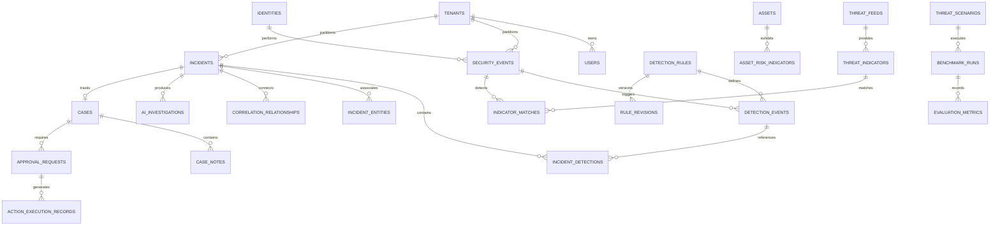

# CyberTrace — Data Model & API Contracts Specification
## Relational Schema Architecture, SQLAlchemy Models & Versioned REST Endpoints

---

## 1. Relational Database Schema & Entity Relationships

The CyberTrace persistence layer utilizes SQLAlchemy 2.0 with asynchronous drivers (`aiosqlite` for local development; `asyncpg` for production PostgreSQL). All timestamps are stored as timezone-aware UTC (`DateTime(timezone=True)`).



---

## 2. SQLAlchemy Model Definitions

### 2.1 Core Telemetry & Incident Schema (Existing)
- **`SecurityEventModel` (`security_events`):** Stores normalized Common Event Schema (CES) records. Primary key: `id` (e.g. `evt_...`). Unique constraints on `(id, tenant_id)`. Indexed by `timestamp`, `category`, `action`, `username`, `source_ip`, `hostname`.
- **`DetectionRuleModel` (`detection_rules`):** Catalogs authoritative detection rules. Indexed by `rule_id` (`DET-001`, `DET-002`, etc.), `severity`, `is_active`.
- **`DetectionEventModel` (`detection_events`):** Records rule executions. Stores `rule_id`, `entity_type`, `entity_value`, `detected_at`, `explanation`.
- **`IncidentModel` (`incidents`):** Correlated incident entities. Stores `correlation_key`, `title`, `severity`, `status`, `first_seen`, `last_seen`.
- **`AIInvestigationModel` (`ai_investigations`):** Persists investigation findings. Stores `model_id`, `status` (`completed`, `fallback`), `executive_summary`, `structured_result` (JSON), `event_citations` (JSON), `tool_call_count`, `duration_seconds`, `request_id`, `created_at`.

### 2.2 Advanced Platform Models (New Extensions)

#### Detection-as-Code & Sigma Subsystem
```python
class DetectionRuleDefinitionModel(Base):
    __tablename__ = "detection_rule_definitions"

    id: Mapped[str] = mapped_column(String(64), primary_key=True)
    rule_id: Mapped[str] = mapped_column(String(32), unique=True, index=True)
    title: Mapped[str] = mapped_column(String(256), nullable=False)
    description: Mapped[str] = mapped_column(Text, nullable=False)
    severity: Mapped[str] = mapped_column(String(16), nullable=False, index=True)
    sigma_yaml: Mapped[str] = mapped_column(Text, nullable=False)
    mitre_attack_tactics: Mapped[List[str]] = mapped_column(JSON, default=list)
    mitre_attack_techniques: Mapped[List[str]] = mapped_column(JSON, default=list)
    is_active: Mapped[bool] = mapped_column(Boolean, default=True, index=True)
    version: Mapped[int] = mapped_column(Integer, default=1)
    created_at: Mapped[datetime] = mapped_column(DateTime(timezone=True), default=lambda: datetime.now(timezone.utc))
    updated_at: Mapped[datetime] = mapped_column(DateTime(timezone=True), default=lambda: datetime.now(timezone.utc))

    revisions: Mapped[List["RuleRevisionModel"]] = sa_relationship("RuleRevisionModel", back_populates="rule")


class RuleRevisionModel(Base):
    __tablename__ = "rule_revisions"

    id: Mapped[str] = mapped_column(String(64), primary_key=True)
    rule_id: Mapped[str] = mapped_column(String(32), ForeignKey("detection_rule_definitions.rule_id", ondelete="CASCADE"), index=True)
    version: Mapped[int] = mapped_column(Integer, nullable=False)
    sigma_yaml: Mapped[str] = mapped_column(Text, nullable=False)
    change_summary: Mapped[str] = mapped_column(String(512), nullable=False)
    author_id: Mapped[str] = mapped_column(String(64), nullable=False)
    created_at: Mapped[datetime] = mapped_column(DateTime(timezone=True), default=lambda: datetime.now(timezone.utc))

    rule: Mapped["DetectionRuleDefinitionModel"] = sa_relationship("DetectionRuleDefinitionModel", back_populates="revisions")
```

#### Assets & Identity Intelligence
```python
class AssetInventoryModel(Base):
    __tablename__ = "asset_inventory"

    id: Mapped[str] = mapped_column(String(64), primary_key=True)
    hostname: Mapped[str] = mapped_column(String(128), unique=True, index=True)
    asset_type: Mapped[str] = mapped_column(String(32), nullable=False) # server, workstation, domain_controller, gateway
    criticality: Mapped[str] = mapped_column(String(16), nullable=False, index=True) # tier_1, tier_2, tier_3, tier_4
    ip_addresses: Mapped[List[str]] = mapped_column(JSON, default=list)
    owner: Mapped[Optional[str]] = mapped_column(String(128), nullable=True)
    os_info: Mapped[Optional[str]] = mapped_column(String(128), nullable=True)
    first_seen: Mapped[datetime] = mapped_column(DateTime(timezone=True), nullable=False)
    last_seen: Mapped[datetime] = mapped_column(DateTime(timezone=True), nullable=False, index=True)
    tags: Mapped[List[str]] = mapped_column(JSON, default=list)


class IdentityProfileModel(Base):
    __tablename__ = "identity_profiles"

    id: Mapped[str] = mapped_column(String(64), primary_key=True)
    username: Mapped[str] = mapped_column(String(128), unique=True, index=True)
    display_name: Mapped[Optional[str]] = mapped_column(String(128), nullable=True)
    identity_type: Mapped[str] = mapped_column(String(32), default="user") # user, service_account, admin
    department: Mapped[Optional[str]] = mapped_column(String(64), nullable=True)
    observed_ips: Mapped[List[str]] = mapped_column(JSON, default=list)
    failed_logon_count_24h: Mapped[int] = mapped_column(Integer, default=0)
    last_successful_logon: Mapped[Optional[datetime]] = mapped_column(DateTime(timezone=True), nullable=True)
    risk_score: Mapped[int] = mapped_column(Integer, default=0) # 0 - 100
```

#### ThreatLab Benchmark & Replay Subsystem
```python
class ThreatScenarioModel(Base):
    __tablename__ = "threat_scenarios"

    id: Mapped[str] = mapped_column(String(64), primary_key=True)
    name: Mapped[str] = mapped_column(String(128), unique=True, index=True)
    description: Mapped[str] = mapped_column(Text, nullable=False)
    attack_category: Mapped[str] = mapped_column(String(64), nullable=False)
    event_count: Mapped[int] = mapped_column(Integer, nullable=False)
    expected_detection_count: Mapped[int] = mapped_column(Integer, nullable=False)
    expected_rule_ids: Mapped[List[str]] = mapped_column(JSON, default=list)
    dataset_file_path: Mapped[str] = mapped_column(String(256), nullable=False)
    created_at: Mapped[datetime] = mapped_column(DateTime(timezone=True), default=lambda: datetime.now(timezone.utc))


class BenchmarkRunModel(Base):
    __tablename__ = "benchmark_runs"

    id: Mapped[str] = mapped_column(String(64), primary_key=True)
    scenario_id: Mapped[str] = mapped_column(String(64), ForeignKey("threat_scenarios.id", ondelete="CASCADE"), index=True)
    executed_by: Mapped[str] = mapped_column(String(64), nullable=False)
    true_positives: Mapped[int] = mapped_column(Integer, nullable=False)
    false_positives: Mapped[int] = mapped_column(Integer, nullable=False)
    false_negatives: Mapped[int] = mapped_column(Integer, nullable=False)
    precision: Mapped[float] = mapped_column(Float, nullable=False)
    recall: Mapped[float] = mapped_column(Float, nullable=False)
    f1_score: Mapped[float] = mapped_column(Float, nullable=False)
    duration_seconds: Mapped[float] = mapped_column(Float, nullable=False)
    executed_at: Mapped[datetime] = mapped_column(DateTime(timezone=True), default=lambda: datetime.now(timezone.utc), index=True)
```

#### SOC Case Management & Response Playbooks
```python
class CaseModel(Base):
    __tablename__ = "cases"

    id: Mapped[str] = mapped_column(String(64), primary_key=True)
    incident_id: Mapped[str] = mapped_column(String(64), ForeignKey("incidents.id", ondelete="CASCADE"), unique=True, index=True)
    title: Mapped[str] = mapped_column(String(256), nullable=False)
    priority: Mapped[str] = mapped_column(String(16), default="P2", index=True) # P1, P2, P3, P4
    status: Mapped[str] = mapped_column(String(32), default="new", index=True) # new, in_progress, pending_approval, closed
    assignee_id: Mapped[Optional[str]] = mapped_column(String(64), nullable=True, index=True)
    created_at: Mapped[datetime] = mapped_column(DateTime(timezone=True), default=lambda: datetime.now(timezone.utc), index=True)
    updated_at: Mapped[datetime] = mapped_column(DateTime(timezone=True), default=lambda: datetime.now(timezone.utc))
    closed_at: Mapped[Optional[datetime]] = mapped_column(DateTime(timezone=True), nullable=True)
    closure_reason: Mapped[Optional[str]] = mapped_column(String(128), nullable=True)

    notes: Mapped[List["CaseNoteModel"]] = sa_relationship("CaseNoteModel", back_populates="case")
    approvals: Mapped[List["ApprovalRequestModel"]] = sa_relationship("ApprovalRequestModel", back_populates="case")


class ApprovalRequestModel(Base):
    __tablename__ = "approval_requests"

    id: Mapped[str] = mapped_column(String(64), primary_key=True)
    case_id: Mapped[str] = mapped_column(String(64), ForeignKey("cases.id", ondelete="CASCADE"), index=True)
    playbook_id: Mapped[str] = mapped_column(String(64), nullable=False)
    action_name: Mapped[str] = mapped_column(String(128), nullable=False)
    rationale: Mapped[str] = mapped_column(Text, nullable=False)
    target_entity: Mapped[str] = mapped_column(String(128), nullable=False)
    status: Mapped[str] = mapped_column(String(32), default="pending", index=True) # pending, approved, rejected
    requested_by: Mapped[str] = mapped_column(String(64), nullable=False)
    decided_by: Mapped[Optional[str]] = mapped_column(String(64), nullable=True)
    decision_reason: Mapped[Optional[str]] = mapped_column(String(256), nullable=True)
    created_at: Mapped[datetime] = mapped_column(DateTime(timezone=True), default=lambda: datetime.now(timezone.utc))
    decided_at: Mapped[Optional[datetime]] = mapped_column(DateTime(timezone=True), nullable=True)

    case: Mapped["CaseModel"] = sa_relationship("CaseModel", back_populates="approvals")
```

---

## 3. Versioned REST API Specifications (`/api/v1`)

### 3.1 Overview & System
- `GET /api/v1/health`: Returns API health, service name, and version.
- `GET /api/v1/overview/stats`: Returns operational overview metrics (incident severity counts, monitored asset counts, detection coverage percentage, model provider health). Data tagged with `provenance: "live_telemetry"` or `"synthetic_benchmark"`.

### 3.2 Ingestion & Interoperability
- `POST /api/v1/logs/upload`: Multipart file upload (bounded max 50 MB) supporting JSON, CSV, Syslog, Windows, Zeek. Returns parsed event count, detection count, and incident count.
- `POST /api/v1/interop/ocsf/export`: Accepts incident ID; returns standardized OCSF 1.1 JSON object array.
- `POST /api/v1/interop/ocsf/import`: Ingests standard OCSF JSON records and maps them to CES.

### 3.3 Detection Engineering
- `GET /api/v1/rules`: Lists detection rules with filters for `is_active`, `severity`, `mitre_tactic`.
- `POST /api/v1/rules`: Creates a new detection rule (accepts YAML Sigma subset or structured parameters).
- `PUT /api/v1/rules/{rule_id}`: Updates rule definition and records a new revision.
- `POST /api/v1/rules/{rule_id}/toggle`: Enables or disables a rule with audit reason.
- `GET /api/v1/rules/mitre-matrix`: Returns ATT&CK coverage heatmap matrix with rule counts per tactic/technique.

### 3.4 Threat Hunting
- `POST /api/v1/hunting/query`: Executes structured search filter.
  - *Request Body:*
    ```json
    {
      "time_range": {"start": "2026-11-01T00:00:00Z", "end": "2026-11-01T23:59:59Z"},
      "filters": [
        {"field": "username", "operator": "eq", "value": "svc_deploy"},
        {"field": "action", "operator": "in", "value": ["logon_failure", "elevation_attempt"]}
      ],
      "limit": 100,
      "offset": 0
    }
    ```
- `GET /api/v1/hunting/saved`: Retrieves saved hunt queries.
- `POST /api/v1/hunting/saved`: Saves a hunt query with title and hypothesis notes.

### 3.5 Incidents & Investigation
- `GET /api/v1/incidents`: Lists correlated incidents with filters for status, severity, time range.
- `GET /api/v1/incidents/{incident_id}`: Returns incident dossier (metadata, detections, events, entities).
- `GET /api/v1/incidents/{incident_id}/graph`: Returns graph nodes and edges for React Flow visualization, with edges explicitly typed as `observed`, `correlated`, or `inferred`.
- `POST /api/v1/incidents/{incident_id}/investigate`: Starts an AI or fallback investigation.
  - *Query Param:* `model_id` (optional: `qwen-3.8-27b`, `deepseek-v4.1-flash`, or `auto`).
  - *Response:* `InvestigationResponse` (executive summary, observed facts, hypotheses, unknowns, recommended actions, limitations).
- `GET /api/v1/incidents/{incident_id}/investigations`: Lists historical investigations.
- `GET /api/v1/incidents/{incident_id}/investigations/{investigation_id}`: Fetches specific investigation run.

### 3.6 ThreatLab (Evaluation Studio)
- `GET /api/v1/threatlab/scenarios`: Catalogs available synthetic attack scenarios.
- `POST /api/v1/threatlab/replay`: Executes a replay run of a scenario against active detection rules.
  - *Request:* `{"scenario_id": "scen_brute_exfil_01", "rule_ids": ["DET-001", "DET-002", "DET-004"]}`
  - *Response:* `BenchmarkRunResponse` containing TP, FP, FN, Precision, Recall, F1 score, and missed event IDs.

### 3.7 SOC Case Management & Playbooks
- `POST /api/v1/cases`: Opens a case linked to an incident.
- `GET /api/v1/cases/{case_id}`: Retrieves case status, SLA, assigned analyst, and notes.
- `POST /api/v1/cases/{case_id}/notes`: Appends an investigation note.
- `POST /api/v1/cases/{case_id}/playbooks/simulate`: Simulates running a response playbook.
- `POST /api/v1/cases/{case_id}/approvals/{approval_id}/decide`: Approves or rejects a response action.

### 3.8 Asset & Identity Intelligence (Phase 6.1)
- `GET /api/v1/assets`: Paginated list of observed assets (hostnames and IPs) derived directly from `security_events`.
  - *Query Params:* `asset_type` (`hostname` | `ip`), `search` (substring match), `limit` (max 200, default 50), `offset` (default 0).
  - *Ordering:* Global database-level sort on `last_seen DESC, asset_value ASC, asset_type ASC`.
  - *Provenance:* Marked with `"provenance": "observed_telemetry"`.
- `GET /api/v1/assets/{asset_type}/{asset_value}`: Detailed profile for a specific observed asset.
  - *Parameters:* `asset_type` (`hostname` | `ip`), `asset_value` (URL-decoded path parameter).
  - *Normalization:* Hostnames normalized to uppercase; IPs trimmed.
  - *Payload:* `AssetDetail` containing first seen, last seen, distinct event counts (source/destination/total), detection count, incident count, triggered detection rules summary, and linked incident IDs.
  - *Response:* Returns 404 when not observed in any ingested event.
- `GET /api/v1/identities`: Paginated list of observed user identities derived from `security_events.username`.
  - *Query Params:* `search` (substring match), `limit` (max 200, default 50), `offset` (default 0).
  - *Normalization:* Canonical lowercase grouping (`LOWER(TRIM(username))`).
  - *Ordering:* `last_seen DESC, username ASC`.
  - *Provenance:* Marked with `"provenance": "observed_telemetry"`.
- `GET /api/v1/identities/{username}`: Detailed profile for a specific observed user identity.
  - *Parameters:* `username` (URL-decoded path parameter; canonical lowercase lookup).
  - *Payload:* `IdentityDetail` containing first seen, last seen, distinct event count, detection count, incident count, triggered detection rules, and linked incident IDs.
  - *Response:* Returns 404 when not observed in any ingested event.
