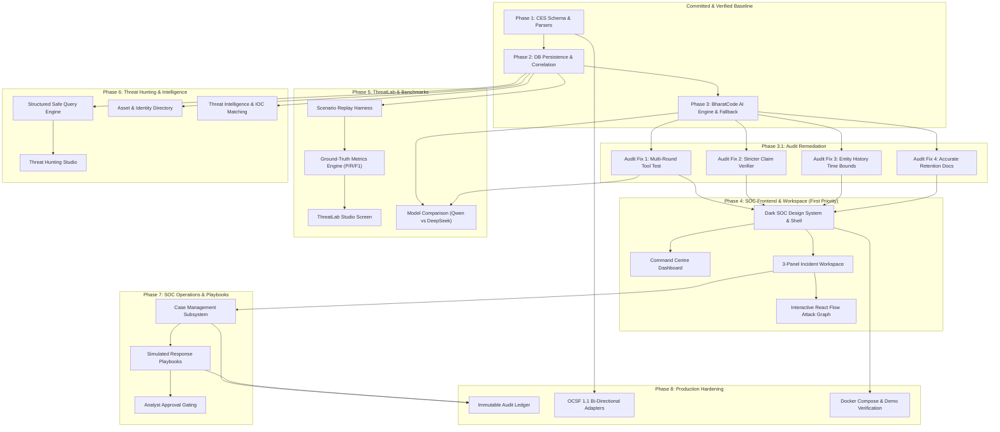

# CyberTrace — Implementation Roadmap & Phased Execution Plan
## Technical Dependency Topology, Feature Blueprints & Milestone Boundaries

---

## 1. Feature Dependency Topology

The following directed graph maps the technical dependencies across CyberTrace's 12 core modules. Under no circumstances should downstream operational features be implemented before their foundational telemetry and persistence dependencies are verified:



---

## 2. Milestone Categorization

| Tier | Phases Included | Scope & Objective |
| :--- | :--- | :--- |
| **Hackathon Deliverable**<br/>*(Target: 10 Nov 2026)* | **Phases 3.1, 4, 5, core of 6 & 7** | A complete, functional, premium SOC investigation platform: interactive 3-panel workspace, live attack graph, BharatCode model routing, ThreatLab replay with exact precision/recall calculation, structured threat hunting, and simulated playbooks. |
| **Near-Term Product** | **Phase 8 (Part 1)** | PostgreSQL deployment target, OCSF 1.1 adapters, community Sigma subset import/export, and team-based case assignments. |
| **Long-Term Production** | **Phase 8 (Part 2)** | Enterprise SAML/SSO integration, multi-tenant database partitioning, distributed Celery/Redis worker clusters, and live cloud EDR connectors. |

---

## 3. Detailed Feature Specifications & Execution Blueprint

---

### Feature 1: Phase 3.1 Audit Remediation & AI Engine Hardening
- **Problem Solved:** Closes the 4 critical audit items identified during the Phase 3 audit, ensuring multi-turn tool loops are verified across $\ge 2$ consecutive rounds, unsupported hypotheses are omitted, entity history supports time bounds, and documentation is accurate.
- **User Workflow:** Transparent backend hardening; analyst benefits from strictly grounded findings and accurate temporal filtering.
- **Frontend Screens:** None (Backend & Test Suite only).
- **Backend Services:** `InvestigationToolExecutor`, `EvidenceVerifier`, `BharatCodeAgent`, `test_investigation.py`.
- **Database Changes:** None.
- **API Contracts:** `query_entity_history` accepts optional ISO-8601 `start_time` and `end_time`.
- **Security Requirements:** All time strings sanitized and validated against standard ISO formats.
- **Acceptance Criteria:**
  - `query_entity_history` filters events on `start_time <= event.timestamp <= end_time`.
  - Hypotheses with 0 verified event IDs are omitted or categorized as ungrounded.
  - Test executing 2 consecutive tool calls passes and confirms accumulated conversation history replay.
- **Tests:** $\ge 64$ backend tests passing; zero regressions.
- **Complexity:** Low (1 day).

---

### Feature 2: Refined Warm Graphite SOC Shell & Design System (Phase 4.1)
- **Problem Solved:** Delivers the visual identity, navigation layout, responsive shell, and typography of an enterprise-grade dark SOC command center.
- **User Workflow:** Analyst logs in or opens CyberTrace; navigates seamlessly between Command, Intelligence, Engineering, Environment, and Administration via collapsible sidebar.
- **Frontend Screens:** Global Application Shell, Header (Search, Time Range, Notifications), Sidebar, Navigation Routing, Command Centre.
- **Backend Services:** `/api/v1/health`, `/api/v1/overview/stats`.
- **Database Changes:** None.
- **API Contracts:** Standard JSON response for health and overview counters.
- **Security Requirements:** Zero external CDN dependencies; all assets packaged locally.
- **Acceptance Criteria:**
  - Warm Graphite & Restrained Bronze aesthetic (`#111315`, `#1D2125`, `#B58A61`, Inter + JetBrains Mono) adhering to `UI_DESIGN_SYSTEM.md`.
  - Responsive layout (content-sized incident queue, tablet-adapted stacked layout below 1280px).
  - Global search (`⌘K`) hotkey listener functional.
- **Status:** **Completed & Verified.**
- **Complexity:** Medium (2 days).

---

### Feature 3: Interactive Three-Panel Incident Workspace & Dagre Attack Graph (Phase 4.2)
- **Problem Solved:** Solves alert fatigue and fragmented data by displaying incident metadata, interactive hierarchical attack graph, and AI findings side-by-side with interactive evidence citations.
- **User Workflow:** Analyst clicks an incident $\to$ inspects chronological timeline $\to$ navigates attack graph $\to$ clicks "Investigate" $\to$ watches Qwen 3.8 27B execute tool rounds $\to$ clicks `[evt_001]` citation to open exact raw evidence drawer.
- **Frontend Screens:** Incident Detail View (`/incidents/:id`), Interactive Attack Graph Canvas (React Flow + `@dagrejs/dagre`), Evidence Drawer Modal, Entity Inspector.
- **Backend Services:** `GET /api/v1/incidents/{id}`, `GET /api/v1/incidents/{id}/graph`, `POST /api/v1/incidents/{id}/investigate`, `PATCH /api/v1/incidents/{id}/status`.
- **Database Changes:** `ai_investigations` table stores graph node coordinates if customized.
- **API Contracts:** `IncidentGraphResponse` returning nodes (`user`, `host`, `ip`, `detection`) and edges (`observed`, `correlated`, `inferred`).
- **Security Requirements:** Event payloads rendered in Evidence Drawer are sanitized; no arbitrary script execution.
- **Acceptance Criteria:**
  - Dagre automatic hierarchical DAG layout (`LR` and `TB` directions) with deterministic node placement.
  - Dark custom node cards with zero white outlines or glowing halos.
  - Clicking any evidence citation pill highlights timeline and graph node.
  - Edges visually distinguish observed telemetry from engine correlation and model inference.
  - AI findings display observed facts, hypotheses, unknowns, and human-approved actions.
- **Status:** **Completed & Verified.**
- **Complexity:** High (3 days).

---

### Feature 4: CyberTrace ThreatLab & Benchmark Engine (Phase 5)
- **Problem Solved:** Security teams cannot currently measure whether detection rules work effectively or calculate false positive rates without manual testing.
- **User Workflow:** Detection engineer opens ThreatLab $\to$ selects `Multi-Stage Attack Scenario` $\to$ clicks "Run Replay" $\to$ views real-time detection firings $\to$ inspects exact confusion matrix ($TP, FP, FN$, Precision, Recall, $F_1$) $\to$ reviews missed events and optimizes rule.
- **Frontend Screens:** ThreatLab Studio (`/threatlab`), Confusion Matrix Tile, Replay Step Inspector.
- **Backend Services:** `ThreatLabReplayHarness`, `BenchmarkEvaluatorService`.
- **Database Changes:** New tables `threat_scenarios`, `benchmark_runs`, `evaluation_metrics`.
- **API Contracts:** `GET /api/v1/threatlab/scenarios`, `POST /api/v1/threatlab/replay`.
- **Security Requirements:** Replay events executed in an isolated in-memory transaction; production incident data is never polluted.
- **Acceptance Criteria:**
  - Precision, Recall, and $F_1$ calculated with mathematical correctness from known ground-truth events.
  - Side-by-side rule comparison highlighting missed detections.
- **Status:** **Completed & Verified.**
- **Complexity:** High (3 days).

---

### Feature 5: Multi-Model Routing & Evaluation (Phase 5.2)
- **Problem Solved:** Enables dynamic selection between BharatCode's `qwen-3.8-27b` and `deepseek-v4.1-flash`, benchmarking which model performs better on cybersecurity investigation tasks.
- **User Workflow:** Analyst selects model from header dropdown or lets the platform auto-route based on incident complexity $\to$ system evaluates and compares evidence citation accuracy and tool latency.
- **Frontend Screens:** Model Evaluation Screen (`/engineering/model-evaluation`), Model Selector Dropdown.
- **Backend Services:** `BharatCodeModelRouter`, dynamic `GET /models` discovery service.
- **Database Changes:** `ai_investigations.model_id` records active model.
- **API Contracts:** `GET /api/v1/models/available`, `POST /api/v1/incidents/{id}/investigate?model_id=...`.
- **Security Requirements:** All model interactions use `store: false` and server-side secret isolation.
- **Acceptance Criteria:**
  - Graceful fallback when DeepSeek is unconfigured or rate-limited.
  - Side-by-side benchmark table comparing Qwen and DeepSeek on citation accuracy and latency.
- **Status:** **Completed & Verified.**
- **Complexity:** Medium (2 days).

---

### Feature 6: Asset & Identity Intelligence (Phase 6.1 — Completed & Verified)
- **Problem Solved:** Security telemetry lacks aggregated asset and user attribution, forcing analysts to manually correlate IP addresses and hostnames across raw logs.
- **User Workflow:** Backend derives an observed asset and identity inventory directly from ingested `security_events` with canonical grouping, distinct event metrics, and detection/incident counts.
- **Frontend Screens:** Asset Inventory Table (`/assets`), Identity Intelligence Directory (`/identities`).
- **Backend Services:** `AssetRepository`, `IdentityRepository`, REST endpoints `/api/v1/assets` and `/api/v1/identities`.
- **Database Changes:** Zero migrations; zero new tables (derived dynamically from `security_events`, `detections`, and `incident_entities`).
- **API Contracts:** `GET /api/v1/assets`, `GET /api/v1/assets/{asset_type}/{asset_value}`, `GET /api/v1/identities`, `GET /api/v1/identities/{username}`.
- **Security & Integrity Requirements:**
  - Strict canonical case normalization (`UPPER(TRIM(hostname))` and `LOWER(TRIM(username))`).
  - Database-level global pagination before LIMIT/OFFSET.
  - Entity namespace isolation prevents prefix collisions (e.g., `SRV-APP` does not match `SRV-APP-01`).
  - Provenance marked strictly as `observed_telemetry`.
- **Acceptance Criteria & Verification:**
  - 21 unit/integration tests passing (95/95 total backend suite).
  - Zero data mutation from GET endpoints.
- **Status:** **Completed & Verified.**

---

### Feature 7: Threat Hunting Studio & Safe Query Engine (Phase 6.2)
- **Problem Solved:** Analysts need to proactively hunt for emerging threats across historical telemetry without complex SQL syntax or security risks.
- **User Workflow:** Analyst opens Threat Hunting $\to$ constructs filter pills (`user == svc_deploy AND bytes_out > 10MB`) $\to$ executes hunt $\to$ reviews virtualized event table $\to$ selects events $\to$ clicks "Create Incident from Selection".
- **Frontend Screens:** Threat Hunting Studio (`/hunting`), Saved Searches Drawer.
- **Backend Services:** `ThreatHuntingService`, parameterized query builder.
- **Database Changes:** `saved_hunt_queries` table.
- **API Contracts:** `POST /api/v1/hunting/query`, `GET /api/v1/hunting/saved`.
- **Security Requirements:** Zero raw SQL injection vectors; queries compiled strictly via SQLAlchemy parameterized expressions.
- **Acceptance Criteria:**
  - High-performance query execution over 10,000+ events within 200ms.
  - One-click incident generation from selected rows.
- **Complexity:** Medium (2 days).

---

### Feature 8: Frontend Asset, Identity & Threat Hunting Integration (Phase 6.3)
- **Problem Solved:** Connects existing dark SOC frontend views to Phase 6.1 & 6.2 backend APIs, replacing mock fixtures with observed telemetry.
- **Frontend Screens:** `AssetInventory.tsx`, `ThreatHunting.tsx`, `DataProvenanceBadge.tsx`.
- **Key Deliverables:**
  - Extend `DataProvenance` union type in `frontend/src/types/index.ts` to include `"observed_telemetry"`.
  - Update `DataProvenanceBadge.tsx` to render `"observed_telemetry"` using neutral styling (never defaulting to Demo Benchmark).
  - Wire live API fetch hooks into `AssetInventory.tsx`.
- **Complexity:** Low-Medium (1 day).

---

### Feature 8: SOC Case Management & Playbook Approvals (Phase 7)
- **Problem Solved:** Closes the loop from investigation to defensive response coordination with strict human approval gates.
- **User Workflow:** Analyst escalates incident to Case $\to$ assigns Tier 2 investigator $\to$ adds investigation notes $\to$ selects `PB-002: Perimeter Egress IP Blocking` $\to$ clicks "Request Approval" $\to$ Tier 2 Lead enters sign-off rationale $\to$ platform records simulated execution and immutable audit trail.
- **Frontend Screens:** Case Board (`/cases`), Case Detail Workspace, Playbook Approval Modal.
- **Backend Services:** `CaseManagementService`, `PlaybookSimulationEngine`.
- **Database Changes:** `cases`, `case_notes`, `approval_requests`, `action_execution_records`.
- **API Contracts:** `POST /api/v1/cases`, `POST /api/v1/cases/{id}/playbooks/simulate`, `POST /api/v1/cases/{id}/approvals/{aid}/decide`.
- **Security Requirements:** Strict separation of duties; non-destructive execution simulation.
- **Acceptance Criteria:**
  - Case status transitions cleanly through lifecycle states.
  - Zero simulated playbooks execute without explicit approval records.
- **Complexity:** Medium (2 days).

---

### Feature 9: Production Hardening, OCSF Adapters & Packaging (Phase 8)
- **Problem Solved:** Prepares CyberTrace for production deployment, interoperability with external SIEM/EDR tools, and automated demonstration packaging.
- **User Workflow:** Administrator launches platform via Docker Compose; imports OCSF telemetry; reviews immutable audit logs.
- **Frontend Screens:** Audit Log Viewer (`/admin/audit-logs`), Integrations Manager (`/environment/integrations`).
- **Backend Services:** `OcsfAdapter`, `AuditLoggingService`.
- **Database Changes:** `audit_logs` table.
- **API Contracts:** `POST /api/v1/interop/ocsf/export`, `POST /api/v1/interop/ocsf/import`.
- **Security Requirements:** Tamper-evident audit hashing; production PostgreSQL database support.
- **Acceptance Criteria:**
  - Bi-directional conversion between CES and OCSF 1.1 passes schema validation.
  - Single-command demonstration startup.
- **Complexity:** Medium (2 days).

---

## 4. Execution Roadmap Timeline (Hackathon Delivery)

```
Days 1-2: Phase 3.1 Audit Remediation & Test Baseline Hardening
Days 3-5: Phase 4.1 Dark SOC Design System & Application Shell
Days 6-8: Phase 4.2 Three-Panel Incident Workspace & Interactive Attack Graph
Days 9-11: Phase 5 ThreatLab Replay Studio & Multi-Model Benchmarking
Days 12-14: Phase 6 Threat Hunting Studio & Asset Context Intelligence
Days 15-16: Phase 7 Case Management & Simulated Playbook Approvals
Days 17-18: Phase 8 OCSF Adapters, End-to-End Evaluation & Demo Packaging
```

