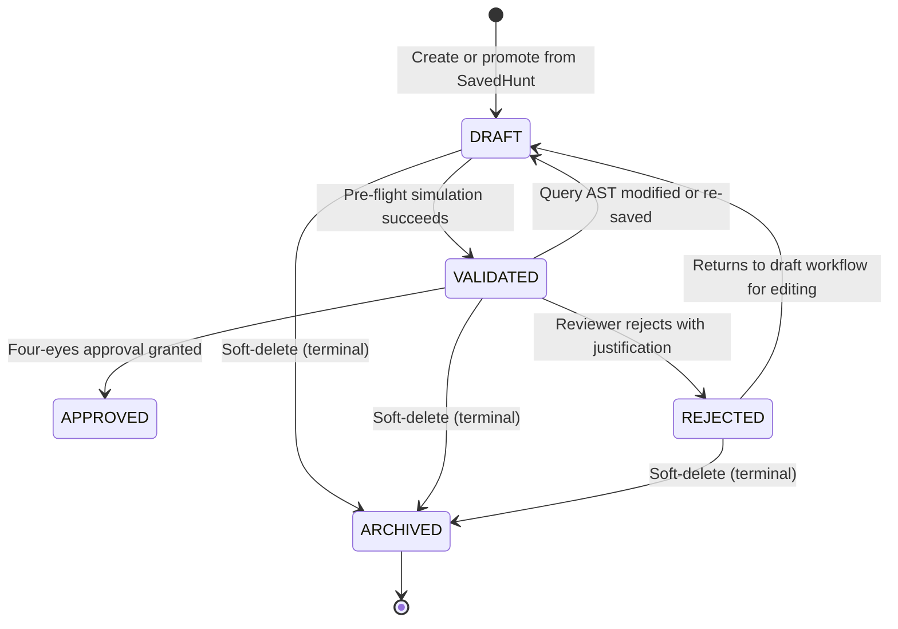
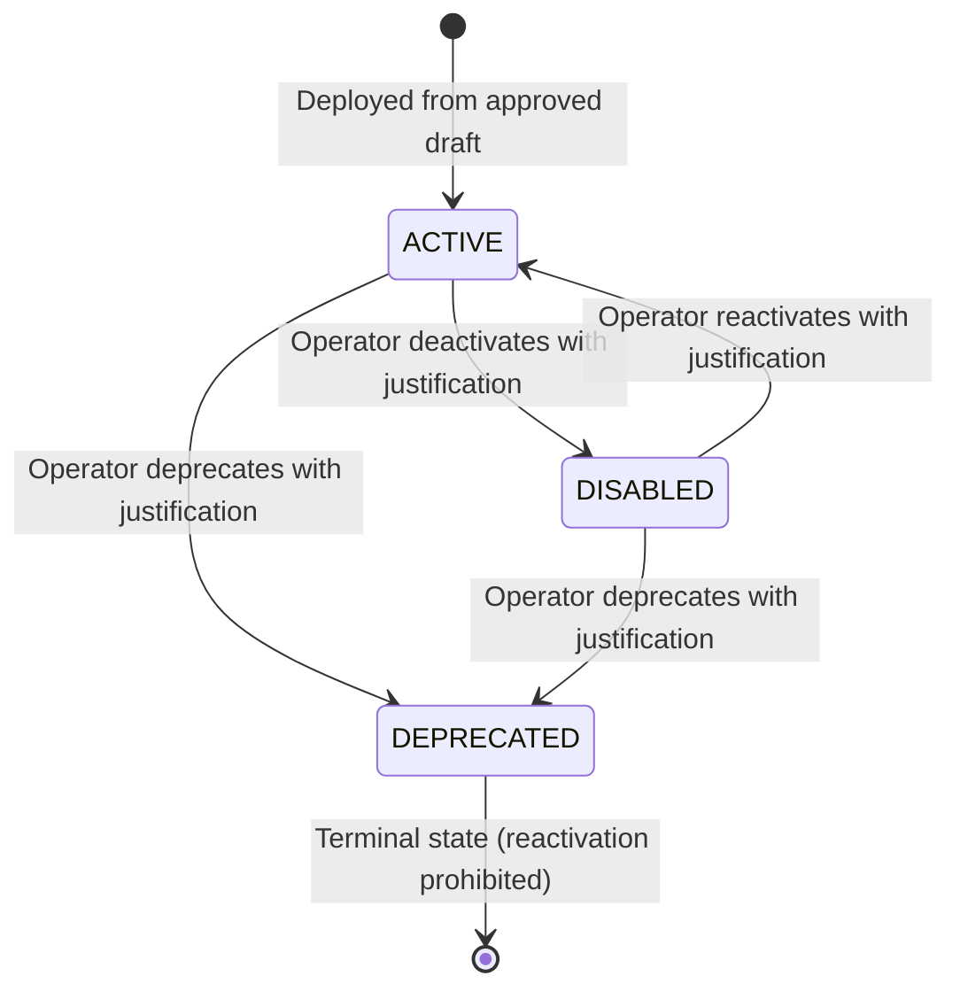

# Architecture Decision Record: Phase 6.3C Governance, Activation & Audit Ledger

**Date:** 2026-11-02  
**Status:** Architecture Refinement (Awaiting User Approval Before Implementation)  
**Branch:** `feature/phase-6.3-saved-hunts-detection-rules`  
**Base Commit:** `b66164b` (`feat(phase-6.3b): add detection rule drafts and pre-flight validation`)  
**Scope:** Phase 6.3C (Analyst Approval, Production Activation, Immutable Audit Ledger, Detection Engine Isolation)

---

## 1. Context & Architectural Problem Statement

Phase 6.3A established persistent, versioned saved threat hunts. Phase 6.3B established detection rule drafts with dual-scope pre-flight validation against historical telemetry and ThreatLab benchmark scenarios.

However, an architectural audit of the transition from candidate drafts to active production rules identified seven critical architectural concerns:
1. **Client-Bypassed Governance:** A client-controlled `allow_demo_self_approval` parameter would permit any API caller to circumvent four-eyes review at will.
2. **Detection Engine Mutation & Contamination:** Appending custom rules to a shared `DetectionEngine.rules` list creates multi-request state leakage, duplicate rules across uploads, and race conditions during concurrent log ingestion.
3. **Audit Ledger Guarantees:** Lack of single-transaction atomicity between state transitions and audit logs could leave orphaned audit entries or unrecorded rule promotions.
4. **Ambiguous Lifecycle States:** Unclear transitions between drafts and active rules, including how rule edits, rejections, and deprecations affect production execution.
5. **Concurrency & Race Conditions:** Potential collisions during simultaneous approvals, draft edits during approval, sequential rule-code allocation (`CUST-001`), and active rule status toggles.
6. **API & Database Contract Boundaries:** Missing strict database-level unique constraints, transaction boundaries, and honest identity disclaimers in API payloads.
7. **Production Verification Coverage:** Need for a comprehensive test matrix proving four-eyes review, single-transaction rollback, engine isolation, and rule provenance.

This Architecture Decision Record (ADR) codifies the definitive architectural blueprint for Phase 6.3C.

---

## 2. Architecture Decisions

### ADR-1: Server-Side Demo Self-Approval Configuration

* **Context:** In standalone demonstration environments or single-analyst hackathon evaluations, requiring two distinct analysts could block workflow demonstrations. However, allowing API callers to pass `allow_demo_self_approval=True` creates an unacceptable security bypass in production.
* **Decision:**
  1. Demo self-approval is controlled **strictly by server-side configuration**, never via client-supplied request parameters.
  2. A new configuration parameter is added to `backend/app/core/config.py`:
     ```python
     ALLOW_DEMO_SELF_APPROVAL: bool = False
     ```
  3. The approval request schema (`RuleDraftApprovalRequest`) **omits any self-approval flag**. The API caller cannot request a bypass.
  4. If `approver_id.strip().lower() == draft.created_by.strip().lower()`:
     - When `ALLOW_DEMO_SELF_APPROVAL is False`: The request is unconditionally rejected with `HTTP 403 Forbidden` (`detail="Four-eyes principle violation: Approver matches draft author. Independent peer review is required."`).
     - When `ALLOW_DEMO_SELF_APPROVAL is True`: The approval proceeds, but the system **unconditionally records a security audit warning** in `rule_audit_ledger`:
       `"security_warning": "SECURITY AUDIT WARNING: Four-eyes principle violated. Self-approval permitted under server-side ALLOW_DEMO_SELF_APPROVAL configuration."`
       and sets `demo_override_flag = True`.
* **Identity Authenticity Disclaimer:**
  - CyberTrace currently operates without an enterprise authentication subsystem, identity provider, or cryptographic session management.
  - All usernames (`created_by`, `approver_id`, `actor`) are **caller-supplied demo metadata**.
  - CyberTrace explicitly disclaims that caller-supplied identities constitute authenticated identities or enterprise RBAC.
  - Every API response involving approvals or lifecycle transitions includes:
    `"author_attribution_note": "Caller-supplied demo identity. Not cryptographically verified or backed by enterprise RBAC."`

---

### ADR-2: Request-Scoped Immutable Detection Engine Isolation

* **Context:** Ingesting security logs via `IncidentService.process_and_correlate_events` evaluates incoming events against detection rules. Mutating a shared `DetectionEngine.rules` instance introduces severe architectural defects:
  - Repeated log uploads accumulate duplicate custom rule instances in memory.
  - Concurrent upload requests corrupt or mutate each other's active rule collections.
  - Disabling or deprecating a rule while an upload is executing causes undefined partial evaluation.
* **Decision:**
  1. **Strict Immutability of Foundational Rules:** `DET-001` through `DET-004` remain hardcoded, immutable, and execute in their exact deterministic order.
  2. **Zero Mutation of Shared Instances:** The shared `DetectionEngine` class is updated to accept an optional immutable sequence of custom rules:
     ```python
     class DetectionEngine:
         def __init__(self, custom_rules: Optional[Sequence[BaseDetectionRule]] = None):
             self.foundational_rules: Tuple[BaseDetectionRule, ...] = (
                 RuleDET001_BruteForce(...),
                 RuleDET002_CompromiseAfterBurst(...),
                 RuleDET003_PrivilegeEscalation(...),
                 RuleDET004_AnomalousOutbound(...),
             )
             self.custom_rules: Tuple[BaseDetectionRule, ...] = tuple(custom_rules or [])
             self.rules: Tuple[BaseDetectionRule, ...] = self.foundational_rules + self.custom_rules
     ```
  3. **Request-Scoped Immutable Snapshot in `IncidentService`:**
     - When `IncidentService.process_and_correlate_events` is invoked, it queries `ActiveRuleRepository` for all active detection rules (`status == "ACTIVE"`).
     - It maps each database record to a `DynamicCustomRule(BaseDetectionRule)` instance.
     - It instantiates a fresh, request-scoped `DetectionEngine(custom_rules=active_custom_rules)`.
     - The event stream is evaluated against this isolated engine.
     - The engine instance is discarded at the end of the request.
  4. **Mid-Flight Rule Status Changes:**
     - If an active rule is disabled, deprecated, or added while an ingestion request is in flight, the in-flight ingestion **completes using its initial frozen snapshot**.
     - Subsequent ingestion requests query the database anew and construct a snapshot reflecting the updated rule state.
     - This guarantees deterministic, atomic log evaluation without partial-state corruption.
  5. **Detection Provenance Preservation:**
     - Every detection generated by a `DynamicCustomRule` explicitly preserves rule provenance in its `metadata` payload:
       - `rule_code`: e.g., `"CUST-001"`
       - `active_rule_id`: `"rule_..."`
       - `source_draft_id`: `"draft_..."`
       - `source_draft_version`: `int`
       - `validation_run_id`: `"val_..."`
       - `rule_type`: `"dynamic_custom_rule"`
       - `mitre_attack_id`: e.g., `"T1041"`
       - `mitre_tactic`: e.g., `"exfiltration"`
       - `matched_event_ids`: `List[str]`

---

### ADR-3: Single-Transaction Audit Ledger Guarantees

* **Context:** The audit ledger must provide a trustworthy historical record of rule governance. Decoupled or asynchronous audit logging risks orphaned audit entries if an operation fails, or unrecorded state transitions if logging fails.
* **Decision:**
  1. **Single-Transaction Atomicity:**
     - State transitions (draft status change, active rule creation, status toggle) and their corresponding `RuleAuditEntryModel` record are committed in the **exact same database transaction** (`async with session.begin():`).
     - If audit entry creation fails, the entire transaction rolls back; no draft or active rule mutation is persisted.
     - If the draft or active rule mutation fails, no audit record is created.
  2. **Application-Level Append-Only Enforcement:**
     - No `UPDATE` or `DELETE` endpoints exist in the REST API surface for audit entries.
     - `RuleAuditRepository` provides only `create_audit_entry()` and `query_audit_entries()`. No update or delete methods exist.
  3. **Snapshot Fidelity:**
     - Every audit entry captures:
       - `state_before`: complete JSON representation of the entity prior to mutation.
       - `state_after`: complete JSON representation of the entity following mutation.
       - `actor`: caller-supplied demo username.
       - `timestamp`: UTC timestamp.
       - `action`: structured action code (`APPROVE_DRAFT`, `REJECT_DRAFT`, `ACTIVATE_RULE`, `DEACTIVATE_RULE`, `REACTIVATE_RULE`, `DEPRECATE_RULE`, `ARCHIVE_DRAFT`).
       - `justification`: mandatory justification rationale (minimum 10 characters).
       - `security_warning`: recorded if server-side demo bypass was utilized.
  4. **Documented Storage Boundary:**
     - CyberTrace explicitly documents that application-level append-only behavior is **not equivalent to database-enforced tamper-proofing** (which would require database user privilege revocation, trigger-enforced `BEFORE UPDATE/DELETE` rejections, or write-once-read-many (WORM) storage).

---

### ADR-4: Rule Lifecycle State Machines

* **Context:** Detection rules progress through distinct creation, testing, governance, and operational phases. Ambiguities between drafts and active rules must be eliminated.
* **Decision:**
  CyberTrace implements two independent, decoupled state machines:

#### 1. Draft Lifecycle State Machine (`detection_rule_drafts`)



- **Transitions & Rules:**
  - `DRAFT`: Initial editable state. Cannot be approved until validated.
  - `VALIDATED`: Successfully evaluated against historical telemetry and ThreatLab benchmarks. Immutable query snapshot bound to validation run.
  - **Stale Validation Reset:** Any mutation to a draft's `query_definition` automatically resets `status` to `DRAFT` and flags previous validation runs as `is_stale = True`.
  - `APPROVED`: Passed four-eyes review. References exact `draft.version` and `validation_run_id`.
  - `REJECTED`: Reviewer rejects draft with mandatory justification (>= 10 chars). State resets to `DRAFT` for author rework. Audit ledger records `REJECT_DRAFT`.
  - `ARCHIVED`: Soft-deleted. Archived drafts cannot be validated, approved, rejected, or activated.

#### 2. Active Rule Lifecycle State Machine (`active_detection_rules`)



- **Transitions & Rules:**
  - `ACTIVE`: Rule is loaded into request-scoped detection engine snapshots and actively evaluates incoming event streams.
  - `DISABLED`: Rule is temporarily suspended. Excluded from detection engine snapshots. Can be reactivated to `ACTIVE` with audited justification.
  - `DEPRECATED`: Rule is permanently retired. Excluded from detection engine snapshots. **Terminal state: reactivation is strictly prohibited.** Any attempt to reactivate a deprecated rule returns `HTTP 409 Conflict`.
  - **Active Rule Immutability:** Active rules are immutable deployed snapshots. Modifying an active rule's query logic requires authoring a new draft (or forking the active rule), passing validation, obtaining four-eyes approval, and deploying as a new active rule while deprecating the prior version.

---

### ADR-5: Concurrency & Race Condition Defense Strategy

* **Context:** Concurrent operator actions in a shared SOC environment can result in race conditions, duplicate rule codes, and inconsistent states.
* **Decision:**

| Concurrency Scenario | Potential Hazard | Safeguard Mechanism | Result / Error Contract |
|---|---|---|---|
| **Simultaneous Approvals** | Two reviewers approve draft v1 at the same millisecond. | Atomic conditional update on `detection_rule_drafts`:<br>`WHERE id = :id AND version = :expected_version AND status = 'VALIDATED' AND is_archived = false`. | Exactly one transaction updates 1 row; second updates 0 rows and aborts with `HTTP 409 Conflict`. |
| **Draft Edit During Approval** | Author modifies draft query AST while approval is pending in-flight. | Draft edit increments `version` and resets status to `DRAFT`. | In-flight approval conditional update matches 0 rows; rolls back with `HTTP 409 Conflict`. |
| **Draft Archival During Approval** | Author archives draft while approval is in-flight. | Archival sets `is_archived = true` and increments `version`. | Approval query checks `is_archived = false`; matches 0 rows; returns `HTTP 409 Conflict`. |
| **Concurrent Rule-Code Allocation** | Two drafts approved concurrently attempt to claim `CUST-001`. | 1. Database schema enforces `UNIQUE` constraint on `active_detection_rules.rule_code`.<br>2. Sequential allocation queries `MAX(CAST(SUBSTR(rule_code, 6) AS INTEGER))` inside the active transaction.<br>3. In PostgreSQL: table-level lock or dedicated sequence. In SQLite: `BEGIN IMMEDIATE` transaction. | If unique constraint violation occurs, transaction rolls back and aborts with `HTTP 409 Conflict` (or retries next integer). |
| **Concurrent Status Toggling** | Operator A disables rule while Operator B deprecates rule. | Optimistic concurrency locking on `active_detection_rules.version`:<br>`WHERE id = :id AND version = :expected_version`. | Exactly one status toggle wins; the second receives `HTTP 409 Conflict`. |
| **Duplicate Approval Request** | Network retry re-submits approval for already approved draft. | Conditional check verifies `status == "VALIDATED"`. | Fails conditional update; returns `HTTP 409 Conflict` ("Draft is already approved"). |
| **Audit Write Failure** | Audit insert fails (e.g., storage error, schema error). | Draft/active rule transition and audit insert share the same transaction boundary (`session.begin()`). | Entire transaction rolls back; draft remains in original state; zero partial writes. |

---

### ADR-6: Database Schema, Integrity Constraints & API Contracts

#### Database Schema Specification (Alembic Down-Revision: `1e6fea4c0cc9`)

```sql
-- Table: active_detection_rules
CREATE TABLE active_detection_rules (
    id VARCHAR(64) PRIMARY KEY,
    rule_code VARCHAR(32) NOT NULL UNIQUE,
    name VARCHAR(128) NOT NULL,
    description TEXT,
    severity VARCHAR(32) NOT NULL,
    mitre_attack_id VARCHAR(64),
    mitre_tactic VARCHAR(64),
    source_draft_id VARCHAR(64) REFERENCES detection_rule_drafts(id) ON DELETE SET NULL,
    source_draft_version INTEGER NOT NULL,
    validation_run_id VARCHAR(64) REFERENCES rule_validation_runs(id) ON DELETE SET NULL,
    query_definition JSON NOT NULL,
    status VARCHAR(32) NOT NULL DEFAULT 'ACTIVE',
    version INTEGER NOT NULL DEFAULT 1,
    approved_by VARCHAR(128) NOT NULL,
    approved_at TIMESTAMP WITH TIME ZONE NOT NULL,
    activated_at TIMESTAMP WITH TIME ZONE NOT NULL,
    deactivated_at TIMESTAMP WITH TIME ZONE,
    created_at TIMESTAMP WITH TIME ZONE NOT NULL,
    updated_at TIMESTAMP WITH TIME ZONE NOT NULL
);

CREATE INDEX ix_active_detection_rules_rule_code ON active_detection_rules(rule_code);
CREATE INDEX ix_active_detection_rules_status ON active_detection_rules(status);
CREATE INDEX ix_active_detection_rules_source_draft_id ON active_detection_rules(source_draft_id);

-- Table: rule_audit_ledger
CREATE TABLE rule_audit_ledger (
    id VARCHAR(64) PRIMARY KEY,
    target_type VARCHAR(32) NOT NULL, -- 'DRAFT' or 'ACTIVE_RULE'
    target_id VARCHAR(64) NOT NULL,
    action VARCHAR(64) NOT NULL,
    actor VARCHAR(128) NOT NULL,
    timestamp TIMESTAMP WITH TIME ZONE NOT NULL,
    justification TEXT NOT NULL,
    state_before JSON NOT NULL,
    state_after JSON NOT NULL,
    demo_override_flag BOOLEAN NOT NULL DEFAULT FALSE,
    security_warning TEXT
);

CREATE INDEX ix_rule_audit_ledger_target ON rule_audit_ledger(target_type, target_id);
CREATE INDEX ix_rule_audit_ledger_action ON rule_audit_ledger(action);
CREATE INDEX ix_rule_audit_ledger_actor ON rule_audit_ledger(actor);
CREATE INDEX ix_rule_audit_ledger_timestamp ON rule_audit_ledger(timestamp DESC);
```

#### API Contracts & HTTP Status Code Mappings

| Endpoint | Method | Success | Client Error | Auth/Governance Error | Conflict Error | Not Found |
|---|---|---|---|---|---|---|
| `/api/v1/rules/drafts/{id}/approve` | `POST` | `200 OK` | `400 Bad Request`<br>(justification < 10 chars) | `403 Forbidden`<br>(self-approval without demo bypass) | `409 Conflict`<br>(not VALIDATED, stale run, version mismatch, archived) | `404 Not Found`<br>(draft not found) |
| `/api/v1/rules/drafts/{id}/reject` | `POST` | `200 OK` | `400 Bad Request`<br>(justification < 10 chars) | N/A | `409 Conflict`<br>(not VALIDATED, archived) | `404 Not Found`<br>(draft not found) |
| `/api/v1/rules/active` | `GET` | `200 OK` | `400 Bad Request`<br>(invalid query params) | N/A | N/A | N/A |
| `/api/v1/rules/active/{id}` | `GET` | `200 OK` | N/A | N/A | N/A | `404 Not Found`<br>(rule not found) |
| `/api/v1/rules/active/{id}/status` | `PATCH` | `200 OK` | `400 Bad Request`<br>(invalid status, justification < 10 chars) | N/A | `409 Conflict`<br>(version mismatch, reactivating DEPRECATED rule) | `404 Not Found`<br>(rule not found) |
| `/api/v1/rules/audit` | `GET` | `200 OK` | `400 Bad Request`<br>(invalid query params) | N/A | N/A | N/A |

---

### ADR-7: Comprehensive Verification & Test Matrix

Phase 6.3C requires a minimum of 24 dedicated test cases across six functional domains:

```
+---------------------------------------------------------------------------------------+
|                                Phase 6.3C Test Matrix                                 |
+---------------------------------------------------------------------------------------+
| 1. Four-Eyes Review & Approval (6 tests)                                              |
|    - test_approve_draft_by_distinct_analyst_succeeds                                  |
|    - test_self_approval_blocked_when_demo_override_disabled                           |
|    - test_self_approval_allowed_when_demo_override_enabled_with_audit_warning         |
|    - test_approval_fails_if_draft_not_validated                                       |
|    - test_approval_fails_if_validation_run_stale_or_version_mismatched                |
|    - test_approval_fails_if_justification_missing_or_under_10_chars                   |
|                                                                                       |
| 2. Rejection & Lifecycle Reset (3 tests)                                              |
|    - test_reject_draft_resets_status_to_draft_and_records_audit                       |
|    - test_reject_draft_fails_without_justification                                    |
|    - test_reject_draft_fails_if_already_archived_or_not_validated                     |
|                                                                                       |
| 3. Active Rule Lifecycle & Immutability (5 tests)                                     |
|    - test_approval_creates_active_rule_with_sequential_code                           |
|    - test_deactivate_active_rule_with_audited_justification                            |
|    - test_reactivate_disabled_rule_with_audited_justification                          |
|    - test_deprecate_rule_is_terminal_and_blocks_reactivation                          |
|    - test_active_rule_is_immutable_and_unaffected_by_subsequent_draft_changes         |
|                                                                                       |
| 4. Concurrency & Race Condition Safeguards (5 tests)                                  |
|    - test_concurrent_approval_exactly_one_winner_one_409_conflict                     |
|    - test_draft_edit_during_approval_race_results_in_409_conflict                     |
|    - test_draft_archival_during_approval_results_in_409_conflict                      |
|    - test_concurrent_active_rule_code_allocation_guarantees_uniqueness                |
|    - test_concurrent_status_toggle_optimistic_locking_prevents_lost_update            |
|                                                                                       |
| 5. Audit Ledger Atomicity & Integrity (3 tests)                                       |
|    - test_audit_write_failure_rolls_back_draft_approval_and_rule_activation           |
|    - test_audit_ledger_preserves_exact_before_after_json_snapshots                    |
|    - test_audit_ledger_query_filtering_by_target_actor_and_action                     |
|                                                                                       |
| 6. Detection Engine Isolation & Live Ingestion Integration (4 tests)                  |
|    - test_live_ingestion_creates_request_scoped_engine_without_mutating_shared_state  |
|    - test_active_custom_rule_triggers_detection_with_full_provenance_metadata        |
|    - test_disabled_and_deprecated_rules_excluded_from_ingestion_evaluation           |
|    - test_hardcoded_rules_det001_to_det004_order_and_execution_preserved_exactly    |
+---------------------------------------------------------------------------------------+
```

---

## 3. Detailed Call Site & Engine Integration Review

### `IncidentService` (`backend/app/correlation/service.py`)
Currently:
```python
self.detection_engine = DetectionEngine()
```
Integration Refinement:
- `IncidentService` maintains its repository references (`event_repo`, `detection_repo`, `incident_repo`).
- In `process_and_correlate_events(events, source_file_hash=None)`:
  1. Persist events idempotently via `event_repo.upsert_events`.
  2. Query active detection rules: `active_rules = await self.active_rule_repo.get_active_rules()`.
  3. Instantiate custom rule wrappers: `custom_rule_instances = [DynamicCustomRule.from_model(r) for r in active_rules]`.
  4. Instantiate request-scoped engine: `engine = DetectionEngine(custom_rules=custom_rule_instances)`.
  5. Run multi-pass detection: `detections = engine.evaluate_all(events)`.
  6. Persist detections via `detection_repo.upsert_detections(detections)`.
  7. Run correlation engine: `self.correlation_engine.correlate(detections, events)`.
  8. Persist correlated incidents: `incident_repo.upsert_incident(...)`.
- Shared `DetectionEngine` state is never mutated; multi-request isolation is 100% guaranteed.

### `ThreatLabService` (`backend/app/threatlab/service.py`)
- Continues to instantiate `DetectionEngine()` for baseline scenario evaluations.
- Preserves foundational rules `DET-001` through `DET-004` benchmark integrity without interference from custom rules.

---

## 4. Security & Risk Analysis

1. **Risk: False Sense of Identity Security**
   - *Mitigation:* Explicit disclaimer `"author_attribution_note": "Caller-supplied demo identity. Not cryptographically verified or backed by enterprise RBAC."` returned in all schemas.
2. **Risk: Malicious or Poorly Performing Custom Rule Crippling Ingestion**
   - *Mitigation:* Pre-flight validation gate enforces pre-requisite testing against historical telemetry and ThreatLab benchmarks before approval is unlocked.
3. **Risk: Accidental Re-enabling of Flawed/Vulnerable Retired Rules**
   - *Mitigation:* Terminal `DEPRECATED` state enforced by database check constraints and service-level validation; reactivation returns `HTTP 409 Conflict`.
4. **Risk: Unrecorded State Transition from System Crash**
   - *Mitigation:* Single-transaction atomic commit guarantees either both state change and audit record commit, or neither commits.

---

## 5. Architectural Approval Sign-Off

This ADR specifies all operational boundaries, state transitions, transaction contracts, concurrency safeguards, and test coverage requirements for Phase 6.3C.

Implementation will commence only upon explicit user authorization.

