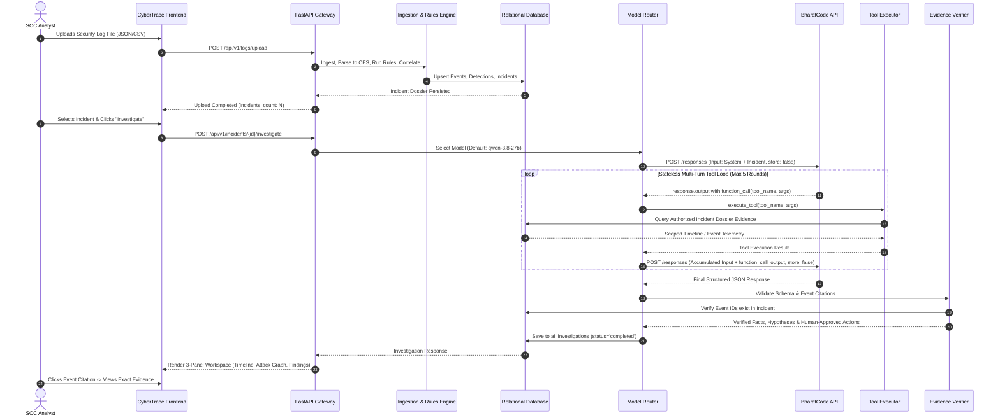
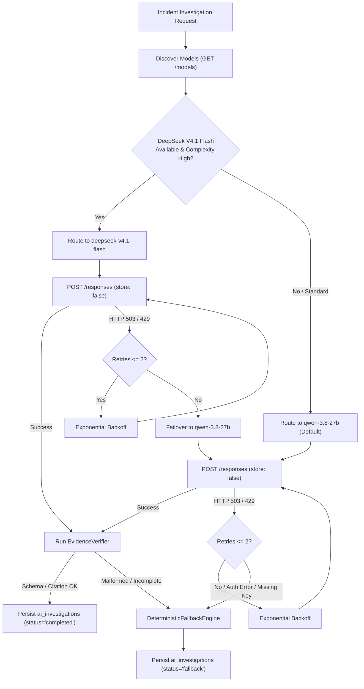
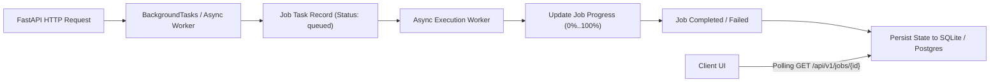

# CyberTrace — Platform Architecture Specification
## System Design, Domain Decomposition & Component Topology

---

## 1. Architectural Philosophy: The Modular Monolith

CyberTrace adopts a **Modular Monolith** architecture for its core application tier, intentionally rejecting premature microservice fragmentation while strictly maintaining internal module boundaries, clear domain interfaces, and decoupled database abstractions.

```
┌────────────────────────────────────────────────────────────────────────┐
│                        CYBERTRACE PRESENTATION TIER                    │
│   React 18 + TypeScript + Vite + Tailwind CSS + Lucide Icons + React Flow│
└───────────────────────────────────┬────────────────────────────────────┘
                                    │ HTTPS / REST JSON API (/api/v1)
┌───────────────────────────────────▼────────────────────────────────────┐
│                    CYBERTRACE MODULAR MONOLITH CORE                    │
│                        (FastAPI / Python 3.12)                         │
│                                                                        │
│  ┌───────────────────────┐ ┌───────────────────────┐ ┌──────────────┐  │
│  │ Ingestion & Parsers   │ │ Detection & Sigma     │ │ Correlation  │  │
│  │ • Pipeline / Adapters │ │ • Rules DET-001..004  │ │ • Safeguards │  │
│  │ • OCSF 1.1 Exporters  │ │ • ATT&CK Matrix       │ │ • Hub-Nodes  │  │
│  └───────────┬───────────┘ └───────────┬───────────┘ └───────┬──────┘  │
│              │                         │                     │         │
│  ┌───────────▼─────────────────────────▼─────────────────────▼──────┐  │
│  │ Intelligence & Investigation Tier                                │  │
│  │ • BharatCode Model Router (Qwen 3.8 27B / DeepSeek V4.1 Flash)    │  │
│  │ • Stateless Investigation Agent & Allow-Listed Tools              │  │
│  │ • Server-Side Evidence Verifier & Deterministic Fallback Engine   │  │
│  │ • Attack Graph Builder, Threat Intel & ThreatLab Replay Engine   │  │
│  └─────────────────────────────────────┬────────────────────────────┘  │
│                                        │                               │
│  ┌─────────────────────────────────────▼────────────────────────────┐  │
│  │ Operations & Management Tier                                     │  │
│  │ • Case Management • Response Playbooks • Audit Logging • RBAC    │  │
│  └─────────────────────────────────────┬────────────────────────────┘  │
└────────────────────────────────────────┼───────────────────────────────┘
                                         │ SQLAlchemy 2.0 (Async)
┌────────────────────────────────────────▼───────────────────────────────┐
│                      PERSISTENCE & STORAGE TIER                        │
│     Development: SQLite + aiosqlite | Production Target: PostgreSQL 16 │
│              Versioned Schema Migrations Managed via Alembic           │
└────────────────────────────────────────────────────────────────────────┘
```

### Why a Modular Monolith?
1. **Defensive Latency & Simplicity:** Security incident correlation requires rapid entity join queries and transactional guarantees. In-memory service calls avoid network serialization overhead, distributed transactions, and RPC failure modes.
2. **Strict Domain Boundaries:** Each domain (Ingestion, Rules, Correlation, Investigation, ThreatLab, Cases) possesses dedicated schemas, repositories, and interfaces. Cross-domain data access must use repository interfaces, never ad-hoc SQL joins.
3. **Seamless Evolutionary Path:** When horizontal scaling becomes necessary for compute-heavy workloads (e.g. massive log ingestion batches or continuous ThreatLab scenario replays), modules can be detached into independent background worker processes using the shared database or a Redis queue without rewriting business logic.

---

## 2. Layered Architecture & Subsystem Decomposition

### Layer 1: Ingestion & Normalization Layer
- **Responsibility:** Ingest raw, heterogeneous log formats, normalize fields into Common Event Schema (CES 2.0), and compute content hashes for audit provenance.
- **Key Modules:**
  - `LogIngestionPipeline`: Dispatches text/files to parser strategies.
  - Parsers: `GenericJsonParser`, `GenericCsvParser`, `LinuxAuthParser`, `WindowsParser`, `ZeekParser`.
  - Adapters: `OcsfAdapter` converting between CES and OCSF Security Finding / Network Activity objects.
- **Contract:** Input: Raw stream or string $\to$ Output: `List[CommonEvent]`.

### Layer 2: Detection & Correlation Engine
- **Responsibility:** Authoritative evaluation of security rules and evidence grouping into correlated incidents.
- **Key Modules:**
  - `DetectionEngine`: Evaluates events against `DetectionRule` classes (`DET-001` brute force, `DET-002` login after failure, `DET-003` privilege escalation, `DET-004` high-volume exfiltration).
  - `SigmaSubsetCompiler`: Compiles YAML Sigma rules into executable Python event predicates.
  - `IncidentCorrelationEngine`: Constructs entity graphs, enforces hub-node protection (rejecting spurious joins on shared web servers or public NAT IPs), enforces temporal thresholds (default 15 minutes), and bounds maximum incident span.
- **Contract:** Input: `List[CommonEvent]` $\to$ Output: `List[DetectionResult]`, `List[CorrelatedIncidentGroup]`.

### Layer 3: Persistence & Data Access Layer
- **Responsibility:** Idempotent, transactionally isolated storage with UTC timestamps and referential integrity.
- **Key Modules:**
  - `EventRepository`: Upserts security events with SHA-256 deduplication.
  - `DetectionRepository`: Persists detections and links to triggering events.
  - `IncidentRepository`: Manages incidents, correlated entities, and dossier evidence.
  - `InvestigationRepository`: Persists AI and fallback investigation records.
  - `CaseRepository`: Manages SOC cases, analyst notes, and playbook records.
  - `ThreatIntelRepository`: Manages IOC indicators and feed metadata.
- **Storage Target:** Asynchronous SQLite (`aiosqlite`) for local development and self-contained testing; PostgreSQL with asyncpg connection pooling for production.

### Layer 4: AI Investigation & Multi-Model Engine
- **Responsibility:** Conduct evidence-backed incident investigations, execute read-only tools, verify citations, and provide deterministic fallbacks.
- **Key Modules:**
  - `BharatCodeModelRouter`: Queries BharatCode `GET /models`, inspects incident complexity, routes to `qwen-3.8-27b` or `deepseek-v4.1-flash`, and handles failovers.
  - `BharatCodeAgent`: Implements stateless Responses API loop with complete conversation history replay and `store: false`.
  - `InvestigationToolExecutor`: Allow-listed, read-only tools scoped strictly to the authorized incident dossier.
  - `EvidenceVerifier`: Validates returned event IDs against database ground truth; rejects hallucinated IDs.
  - `DeterministicFallbackEngine`: Rules-based heuristic investigator ensuring platform utility when models are offline.

### Layer 5: ThreatLab & Analytics Layer
- **Responsibility:** Benchmark detection quality, calculate ground-truth accuracy metrics, and explore attack graphs.
- **Key Modules:**
  - `ScenarioReplayHarness`: Feeds benchmark datasets through selected rule configurations.
  - `BenchmarkEvaluator`: Computes true positives, false positives, false negatives, Precision, Recall, and F1 score.
  - `AttackGraphBuilder`: Traverses entity-event relationships and labels edges (`Observed`, `Correlated`, `Inferred`).
  - `BlastRadiusCalculator`: Evaluates affected assets and crown-jewel exposure.

### Layer 6: Operations & Presentation Tier
- **Responsibility:** Case management, response simulations, and dark SOC UI.
- **Key Modules:**
  - `PlaybookSimulationEngine`: Generates defensive response recommendations and tracks approval workflows.
  - `FastAPI Application`: Versioned REST API endpoints under `/api/v1`.
  - `Frontend SPA`: Single-page React application delivering the dark SOC Command Centre experience.

---

## 3. End-to-End Incident Investigation Lifecycle



---

## 4. Multi-Model Routing & Failover Architecture

BharatCode hosts two inference models accessible via its standard REST API. CyberTrace implements a resilient routing layer:



### Routing Rules & Policies
1. **Dynamic Capability Inspection:** On initialization and scheduled intervals (every 10 minutes), the router calls `GET https://bharatcode.ai/api/model/v1/models`. If `deepseek-v4.1-flash` is present in the account catalogue, it is marked eligible.
2. **Complexity Assessment Criteria:**
   - **Standard Complexity:** Correlated events $\le 50$, detections $\le 3$, entities $\le 5 \to$ Routed to `qwen-3.8-27b`.
   - **High Complexity:** Correlated events $> 50$, detections $> 3$, or multi-host lateral movement $\to$ Routed to `deepseek-v4.1-flash` (if eligible).
   - **Manual Analyst Override:** Analysts can select either model directly in the Investigation Workspace UI.
3. **Graceful Failover Ladder:**
   - Primary complex model failure $\to$ Fallback to standard model `qwen-3.8-27b`.
   - Standard model failure / missing API key / rate-limit exhaustion $\to$ Fallback to `DeterministicFallbackEngine`.
   - Under no circumstances does the application crash or fail to provide an evidence-backed investigation report.

---

## 5. Asynchronous Background Task Architecture

To prevent long-running tasks (e.g. 50 MB log uploads, multi-step threat replays, and batch IOC enrichments) from blocking the FastAPI event loop:



- **Job Task States:** `queued`, `in_progress`, `completed`, `failed`.
- **Bounded Concurrency:** Max 4 concurrent background worker tasks in local mode to avoid thread and database contention.
- **Idempotency Keys:** Log upload tasks calculate `source_file_hash` (SHA-256); identical uploads return existing cached ingestion records without re-processing.
- **Dead-Letter Handling:** Tasks that encounter uncaught exceptions capture the stack trace into `error_message`, transition to `failed`, and emit an audit log entry.

